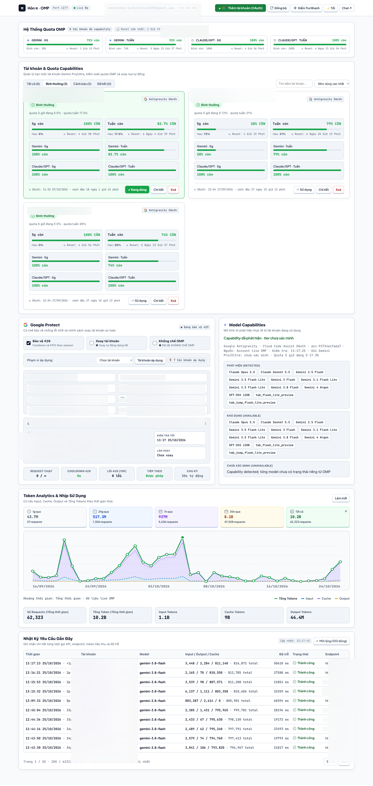
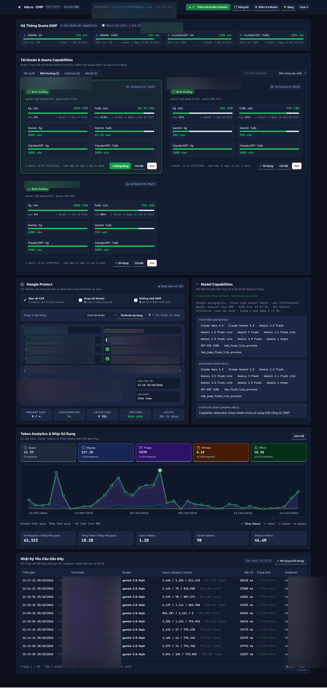
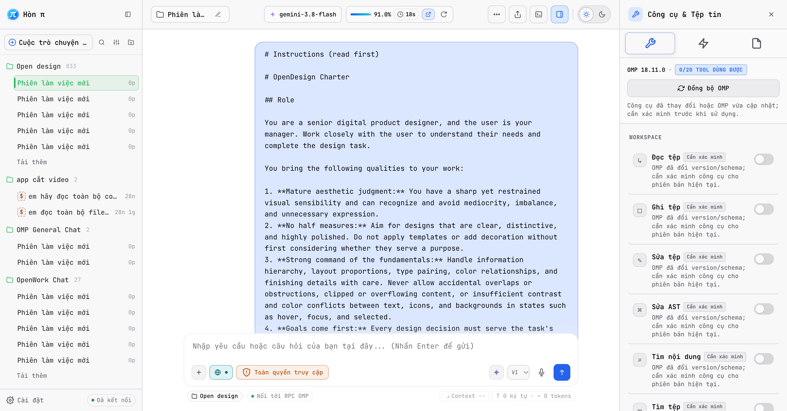
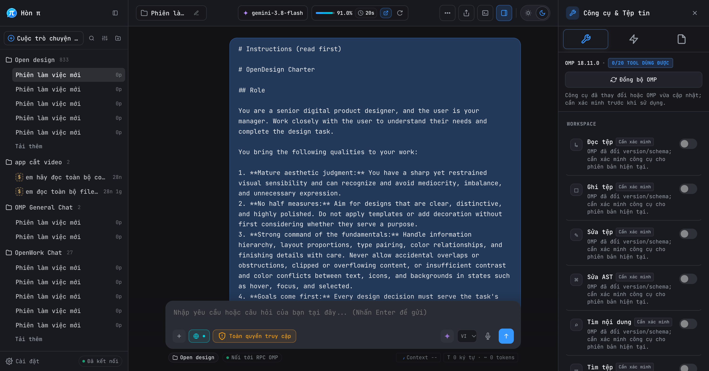

# OMP Dashboard Platform

## Giới thiệu (About)

OMP Dashboard Platform là giao diện cục bộ giúp quản lý các tài khoản Google Gemini đã đăng nhập qua OMP, theo dõi quota và lịch sử sử dụng, đồng thời chọn tài khoản phù hợp cho phiên làm việc. Người dùng có thể lần lượt thêm các tài khoản mình sở hữu hoặc được ủy quyền để tạo pool tài khoản và chủ động chọn giữa chúng. Dashboard không tạo tài khoản Google và không cấp thêm quota; việc đăng nhập, xác thực và sử dụng vẫn do OMP cùng Google xử lý.

### Tác giả và lưu ý sử dụng

Tác giả: **Tuấn Vũng Tàu**.

- Tác giả không khuyến khích dùng công cụ để spam hoặc gửi yêu cầu hàng loạt.
- Người dùng tự chịu trách nhiệm với cách sử dụng, điều khoản dịch vụ và tình trạng tài khoản; tác giả không chịu trách nhiệm nếu Google hạn chế hoặc khóa tài khoản.
- Theo thử nghiệm cá nhân, tài khoản dùng gói Add Family có vẻ dễ bị Google khóa hơn tài khoản mua gói trực tiếp. Đây là quan sát chưa được kiểm chứng độc lập, không phải kết luận hay cam kết của Google.

Chỉ thêm tài khoản mà bạn có quyền sử dụng và tuân thủ điều khoản áp dụng của Google, OMP cùng các dịch vụ liên quan.

Dashboard chạy cục bộ trên macOS để:

- Chat với OMP qua giao diện `/chat`.
- Theo dõi quota Gemini, tài khoản OAuth, trạng thái bảo vệ và lịch sử token qua `/quota`.
- Chọn tài khoản Google ưu tiên cho session OMP.

Dashboard không phải backend cloud, không tự lưu credential Google lên GitHub và không sửa mã nguồn lõi của OMP.

## Giới thiệu chi tiết

OMP Dashboard Platform là giao diện quản lý chạy cùng máy với OMP CLI. Thay vì theo dõi quota bằng lệnh terminal và dùng một cửa sổ riêng để chat, người dùng có thể mở dashboard trên trình duyệt để xem trạng thái tài khoản và làm việc với OMP tại một địa chỉ local.

### Dashboard hỗ trợ những việc gì?

| Khu vực | Mục đích | Chức năng chính |
|---|---|---|
| **Chat — <code>/chat</code>** | Làm việc với OMP qua giao diện web | Tạo và quản lý session, chọn model và công cụ OMP đang cung cấp, gửi prompt, xem phản hồi streaming, xử lý yêu cầu phê duyệt và hủy lượt đang chạy. |
| **Quota — <code>/quota</code>** | Theo dõi các tài khoản Google/OAuth dùng với OMP | Xem quota theo cửa sổ thời gian, trạng thái bảo vệ tài khoản, lịch sử token, biểu đồ sử dụng và chính sách xoay tài khoản khi đã bật cấu hình tương ứng. |
| **Health — <code>/healthz</code>** | Kiểm tra runtime local | Cho installer và người vận hành biết dashboard có đang phản hồi hay không. |

### Dashboard phối hợp với OMP ra sao?

Trình duyệt gửi yêu cầu tới Node.js server trên cùng máy. Server giao tiếp với OMP CLI đã cài trong môi trường người dùng: phần chat dùng luồng ACP của OMP; phần quota đọc trạng thái tài khoản và mức sử dụng do OMP cung cấp. Dashboard là lớp giao diện và điều phối local, không thay thế OMP, không cung cấp model riêng và không tự cấp tài khoản Google.

Luồng sử dụng thông thường là: cài OMP CLI → cài dashboard → mở <code>/quota</code> để đăng nhập/chọn tài khoản và kiểm tra trạng thái → mở <code>/chat</code> để tạo session và trò chuyện. Chức năng khả dụng phụ thuộc phiên bản OMP, model, công cụ và quyền mà OMP hiện có.

### Phạm vi sử dụng

Đây là công cụ cá nhân chạy trên máy macOS, không phải dịch vụ SaaS hay server dùng chung. Dashboard bind vào <code>127.0.0.1</code>; dữ liệu OAuth, session và trạng thái tiếp tục do OMP lưu trong vùng dữ liệu local của người dùng. Không cần cài PI/Open Design wrapper riêng để chạy dashboard. Các giới hạn cài đặt và địa chỉ truy cập được mô tả ở phần [Cần cài gì?](#cần-cài-gì) và [IP, port và phạm vi truy cập](#ip-port-và-phạm-vi-truy-cập).

### Pool tài khoản và lưu ý sử dụng

OMP hỗ trợ đăng nhập Google Gemini; dashboard giúp người dùng đăng nhập lần lượt các tài khoản Gemini mà mình có quyền sử dụng, gom chúng thành một pool để theo dõi quota và chủ động chọn tài khoản cho từng phiên. Pool chỉ giúp quản lý và lựa chọn tài khoản thuận tiện hơn, không làm tăng quota riêng của tài khoản hay miễn trừ giới hạn và điều khoản dịch vụ của Google.

Tác giả **Tuấn Vũng Tàu** không khuyến khích dùng nhiều tài khoản để spam hàng loạt hoặc né giới hạn dịch vụ. Google có thể yêu cầu xác minh, hạn chế hoặc khóa tài khoản; dashboard không bảo đảm tài khoản sẽ tránh được các biện pháp này. Tác giả không chịu trách nhiệm nếu tài khoản bị Google hạn chế hoặc khóa do cách sử dụng; người dùng tự chịu trách nhiệm với cách sử dụng và tình trạng tài khoản của mình.

Theo thử nghiệm nội bộ của tác giả, tài khoản **Add Family** có vẻ dễ bị Google chặn hơn tài khoản mua gói trực tiếp. Đây là quan sát cá nhân, không phải kết luận hay chính sách chính thức của Google, và không bảo đảm áp dụng cho mọi tài khoản.

## Giao diện

Dashboard gồm hai khu vực chính: `/quota` để theo dõi tài khoản, OAuth và quota; `/chat` để chat streaming với OMP.

<p align="center">
  
</p>

### Quota và tài khoản

| Sáng | Tối |
|---|---|
|  |  |

### Chat và công cụ

| Sáng | Tối |
|---|---|
|  |  |

## Kiến trúc và thành phần

```text
Trình duyệt trên cùng máy
        │
        └── http://127.0.0.1:4177
                ├── /chat   → giao diện chat streaming/session/tools
                ├── /quota  → quota, account, OAuth, lịch sử token
                └── /healthz → kiểm tra runtime
                         │
                         └── ~/.bun/bin/omp
                              ├── ACP cho /chat
                              ├── quota/auth cho /quota
                              └── dữ liệu account/session của OMP
```

Runtime production gồm `server.mjs`, `console-bridge.mjs`, ACP worker, các file giao diện SKE và dependency Node trong `product-release/`.

## Cần cài gì?

| Thành phần | Bắt buộc? | Dùng để làm gì? |
|---|---:|---|
| macOS | Có, với installer production | Dùng LaunchAgent, `launchctl`, `plutil` và bộ chọn thư mục native. |
| Node.js | Có | Chạy `server.mjs`. |
| npm | Có | Cài dependency production (`node-pty`, `ws`, xterm). |
| OMP CLI | Có | Dashboard gọi trực tiếp OMP để chat, OAuth, quota và ACP. |
| PI riêng | Không | Dashboard không cần cài một app PI riêng. Biến `PI_CODING_AGENT_DIR` chỉ là tùy chọn nếu muốn trỏ sang thư mục agent khác. |
| Database riêng | Không | Dashboard dùng dữ liệu OMP hiện có và state file cục bộ trong `~/.omp`. |

### Điều kiện quan trọng của OMP

Code hiện tại gọi đúng executable này:

```text
~/.bun/bin/omp
```

Kiểm tra trước khi cài:

```bash
test -x "$HOME/.bun/bin/omp" && echo "OMP OK" || echo "Thiếu ~/.bun/bin/omp"
"$HOME/.bun/bin/omp" --version
node --version
npm --version
```

Repo không bao gồm trình cài OMP. Hãy cài OMP theo bộ cài chính thức của môi trường đang dùng, sau đó bảo đảm binary nằm tại `~/.bun/bin/omp`.

## Cài đặt trên máy mới

### 1. Lấy source

```bash
git clone https://github.com/nhattuan612/omp-dashboard-platform.git
cd omp-dashboard-platform
```

### 2. Cài OMP và Node.js

Hoàn tất điều kiện ở phần trên. Không cần cài PI riêng để chạy dashboard.

### 3. Cài dashboard production

Chạy từ thư mục repo:

```bash
cd product-release
chmod +x install-local-dashboard.sh
./install-local-dashboard.sh
```

Installer sẽ tự:

1. Kiểm tra Node.js, npm và `~/.bun/bin/omp`.
2. Copy runtime vào `~/.omp/usage-dashboard/`.
3. Chạy `npm ci --omit=dev` trong runtime.
4. Copy extension chọn account vào `~/.omp/agent/extensions/omp-account-preference.js`.
5. Tạo LaunchAgent `com.trannhattuan.omp-usage-dashboard`.
6. Khởi động server bằng port `4177` và chờ `/healthz` trả thành công.
7. Tạo backup code-only trước khi thay file runtime.

Khi cài thành công, mở:

- Chat: [http://127.0.0.1:4177/chat](http://127.0.0.1:4177/chat)
- Quota: [http://127.0.0.1:4177/quota](http://127.0.0.1:4177/quota)
- Health: [http://127.0.0.1:4177/healthz](http://127.0.0.1:4177/healthz)

## IP, port và phạm vi truy cập

Server bind cứng vào loopback:

```js
server.listen(PORT, "127.0.0.1", ...)
```

Vì vậy:

- `127.0.0.1` và `localhost` là địa chỉ đúng trên chính máy cài dashboard.
- Port mặc định là `4177`.
- Dashboard không mở cho LAN, không dùng IP Wi-Fi, không dùng public IP và không có ý định chạy trực tiếp qua Internet.
- Máy khác muốn dùng dashboard phải cài và chạy một runtime riêng trên chính máy đó.

Khi chạy Node trực tiếp, port có thể đổi bằng `OMP_DASHBOARD_PORT`; installer production hiện cấu hình cố định `4177` trong LaunchAgent.

## Sử dụng lần đầu

1. Mở `/quota`.
2. Dùng nút thêm/đăng nhập tài khoản để hoàn tất Google OAuth qua OMP.
3. Chờ quota load xong, kiểm tra trạng thái tài khoản và lịch sử token.
4. Chọn account đang dùng nếu cần ưu tiên một tài khoản.
5. Mở `/chat`, tạo hoặc chọn session, chọn model/tool theo quyền OMP rồi gửi prompt.
6. Khi chat cần browser, chỉ bật capability browser khi endpoint local đã sẵn sàng.

Dashboard không tự tạo tài khoản Google. OAuth và credential nằm trong vùng dữ liệu OMP của người dùng.

## Chạy thủ công để phát triển hoặc chẩn đoán

Không cần LaunchAgent khi chỉ muốn chạy tạm:

```bash
npm ci
node server.mjs
```

Sau đó mở `/chat` hoặc `/quota` ở port `4177`. Lệnh này vẫn yêu cầu `~/.bun/bin/omp` nếu dùng chức năng live.

Kiểm tra nhanh:

```bash
curl -fsS http://127.0.0.1:4177/healthz
curl -fsS -o /dev/null -w '%{http_code}\n' http://127.0.0.1:4177/chat
curl -fsS -o /dev/null -w '%{http_code}\n' http://127.0.0.1:4177/quota
```

## Các đường dẫn chính

### Giao diện

| URL | Chức năng |
|---|---|
| `/chat` | Chat streaming, session, tool, approval và browser capability. |
| `/quota` | Account Google, quota 5 giờ/tuần, OAuth, rotation, chart và lịch sử token. |
| `/healthz` | Health check cho installer/LaunchAgent. |

### API chính

| API | Chức năng |
|---|---|
| `GET /api/v1/quota/accounts` | Danh sách account quota live. |
| `GET /api/v1/quota/overview` | Tổng quan quota. |
| `GET /api/v1/quota/history` | Lịch sử token theo khoảng thời gian. |
| `POST /api/v1/quota/switch` | Chuyển account đang ưu tiên. |
| `POST /api/v1/quota/sync` | Đồng bộ quota. |
| `POST /api/v1/chat/send` | Gửi chat request. |
| `GET/POST /api/v1/chat/stream` | Nhận stream chat. |
| `POST /api/v1/chat/abort` | Hủy lượt chat đang chạy. |

API dashboard được bảo vệ bằng session cookie local; không coi đây là API public để expose ra mạng.

## Kiểm tra service và log

```bash
LABEL=com.trannhattuan.omp-usage-dashboard
DOMAIN="gui/$(id -u)"

launchctl print "$DOMAIN/$LABEL"
curl -fsS http://127.0.0.1:4177/healthz
tail -n 100 "$HOME/.omp/usage-dashboard/server.stdout.log"
tail -n 100 "$HOME/.omp/usage-dashboard/server.stderr.log"
```

Nếu port bị chiếm:

```bash
lsof -nP -iTCP:4177 -sTCP:LISTEN
```

Nếu OMP không được tìm thấy:

```bash
ls -l "$HOME/.bun/bin/omp"
"$HOME/.bun/bin/omp" --version
```

Nếu OAuth/proxy dùng CA riêng, đặt CA công khai tại:

```text
~/.omp/usage-dashboard/ca-bundle.pem
```

Runtime tự nạp file này qua `NODE_EXTRA_CA_CERTS`. Không commit file CA vào GitHub.

## Cập nhật dashboard

Từ source mới:

```bash
git pull --ff-only
cd product-release
./install-local-dashboard.sh
```

Installer tạo backup trước khi copy. Script rollback hiện có ở repo là flow bảo trì cho máy maintainer và có đường dẫn cấu hình riêng; trước khi dùng trên máy khác phải kiểm tra các biến đường dẫn trong script:

```bash
cd /path/to/omp-dashboard-platform
./deploy-local-dashboard.sh --rollback "$HOME/.omp/usage-dashboard/backups/deploy/<timestamp>"
```

Chỉ rollback backup nằm bên trong `~/.omp/usage-dashboard/backups/deploy/`.

## Dừng hoặc gỡ dashboard

Dừng LaunchAgent:

```bash
LABEL=com.trannhattuan.omp-usage-dashboard
DOMAIN="gui/$(id -u)"
launchctl bootout "$DOMAIN/$LABEL"
```

Gỡ hoàn toàn cần cân nhắc vì sẽ xóa runtime và state dashboard; dữ liệu account/session của OMP nằm ở vùng khác. Repo hiện chưa có lệnh uninstall tự động, nên không chạy lệnh xóa hàng loạt nếu chưa backup.

## Dữ liệu và bảo mật

Không đưa các dữ liệu sau lên GitHub:

- Google OAuth token/credential.
- Database, session và archive của OMP.
- Account đang chọn, quota state, history cache, log và backup runtime.
- CA bundle riêng của máy.

Các file dashboard được phục vụ local qua loopback. Nếu cần chia sẻ cho người khác, hãy triển khai một lớp gateway/auth riêng; không đổi bind address một cách tùy tiện.

## Kiểm tra source trước khi phát hành

```bash
cmp -s honpi-quota-dashboard-SKE.html product-release/honpi-quota-dashboard-SKE.html
node --check server.mjs
node --check console-bridge.mjs
node --check acp-worker.mjs
sh -n product-release/install-local-dashboard.sh
git diff --check
```

Tài liệu backend/API chi tiết nằm trong [`BACKEND_HANDOFF.md`](BACKEND_HANDOFF.md). `dashboard/` và các HTML legacy là tài sản tham khảo/compatibility, không phải entrypoint production của `/chat` và `/quota`.
