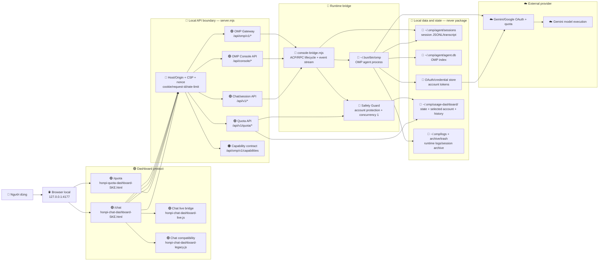
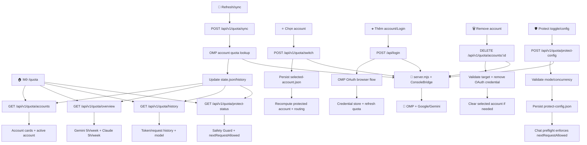
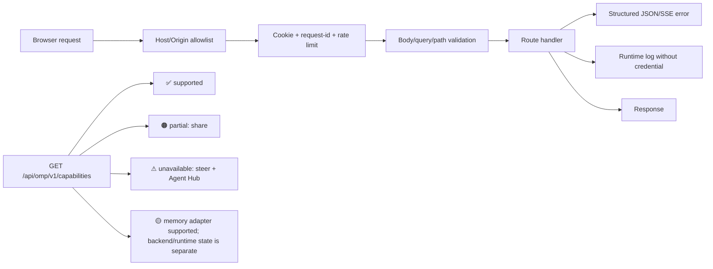

# 🧭 Hòn π · OMP Dashboard — 🔴 IMPORTANT — DO NOT DELETE

> Sơ đồ nghiên cứu và sửa lỗi lưu tại Local. File này không đưa lên GitHub cùng gói sản phẩm.

## 1. Ký hiệu bảo vệ file

| Icon | Mức độ | Quy tắc |
|---|---|---|
| 🔴 | Critical | Không xóa/sửa nếu chưa hiểu luồng; mất file là mất runtime hoặc giao diện chính. |
| 🟠 | Important | Có thể thay đổi có kiểm thử; dùng để vận hành, cài đặt, kiểm tra. |
| 🟢 | Product | Được phép đóng gói cho người dùng cuối. |
| 🔵 | Runtime | Chạy tại máy local trong `~/.omp`; không commit state/credential. |
| ⚪ | Research | Chỉ nghiên cứu local; không đưa vào package public/private product. |
| 🚫 | Exclude | Tuyệt đối không đẩy: tài liệu nội bộ, log, state, session, token, credential, backup. |

## 2. Sơ đồ tổng thể: từ người dùng đến OMP/Gemini



## 3. Các vùng và file chịu trách nhiệm

| Vùng | File/thành phần | Vai trò | Mức |
|---|---|---|---|
| UI Chat | `honpi-chat-dashboard-SKE.html` | Layout, vùng chat, modal, header, quota summary, action buttons | 🔴🟢 |
| UI Chat runtime | `honpi-chat-dashboard-live.js` | Gọi API, SSE stream, render delta/tool/event, session state | 🔴🟢 |
| UI Chat compatibility | `honpi-chat-dashboard-legacy.js` | Fallback action và tương thích browser/contract cũ | 🟠🟢 |
| UI Quota | `honpi-quota-dashboard-SKE.html` | Account cards, quota windows, history, protection panel | 🔴🟢 |
| API/runtime | `~/.omp/usage-dashboard/server.mjs` | HTTP server, route, validation, auth boundary, session/quota orchestration | 🔴🔵 |
| OMP bridge | `~/.omp/usage-dashboard/console-bridge.mjs`, `acp-worker.mjs`, `acp-session-context.mjs` | Shared ACP worker pool, per-chat session routing; RPC console lifecycle remains separate | 🔴🔵 |
| OMP binary | `~/.bun/bin/omp` | Agent loop, model/provider, tool execution | 🔴🔵 |
| LaunchAgent | `~/Library/LaunchAgents/com.trannhattuan.omp-usage-dashboard.plist` | Tự khởi động server sau login | 🟠🔵 |
| Deploy script | `deploy-local-dashboard.sh` | Backup và đồng bộ runtime package assets vào target local | 🟠⚪ |
| Tests | `test-runtime-security.sh`, `test-mock-api.js` | Smoke/security/mock verification | 🟠⚪ |
| Schema | `api-schema.json` | Contract tham khảo cho API | ⚪ |
| Research docs | `tasks/`, `*.md`, handoff/notes | Phân tích, bàn giao, nghiên cứu | ⚪🚫 |

## 4. Flow /chat và toàn bộ action

```mermaid
flowchart TD
  C0[🏠 Mở /chat] --> C1[GET /api/v1/models]
  C0 --> C2[GET /api/v1/sessions]
  C0 --> C3[GET /api/v1/quota/overview]
  C0 --> C4[GET /api/omp/v1/capabilities]
  C1 --> C5[Hiển thị model/thinking/tools]
  C2 --> C6[Hiển thị session list + unread/pin/archive]
  C3 --> C7[Header quota + account availability]
  C4 --> C8[Feature status: supported/partial/unavailable]

  C9[➕ New session] --> A1[POST /api/v1/sessions]
  C10[📂 Chọn session] --> A2[GET /api/v1/sessions/:id/messages]
  C11[✏️ Rename] --> A3[PATCH /api/v1/sessions/:id]
  C12[📌 Pin/unpin] --> A4[PATCH /api/v1/sessions/:id]
  C13[📖 Read/unread] --> A5[PATCH /api/v1/sessions/:id]
  C14[🗄 Archive] --> A6[POST /api/v1/sessions/:id/action]
  C15[🗑 Delete/trash] --> A7[POST /api/v1/sessions/:id/action]
  C16[🧬 Fork] --> A8[POST /api/v1/sessions/:id/action → ACP session/fork]
  C17[🔗 Share local] --> A9[POST /api/v1/sessions/:id/action]

  C18[💬 Send prompt] --> V1[Validate message/model/images]
  V1 --> V2[GET protect-status + quota preflight]
  V2 --> V3[Ensure OMP context/session]
  V3 --> V4[Set model/thinking/fast/tools/approval/browser mode]
  V4 --> V5[POST /api/v1/chat/stream]
  V5 --> V6[SSE start/lifecycle/delta/tool/end/error]
  V6 --> V7[Render text/tool/approval/usage in chat]
  V7 --> V8[Persist transcript + schedule quota refresh]
  V6 -->|429/quota| E1[Show quota blocked + account guidance]
  V6 -->|approval| E2[Approve/deny tool action]
  V6 -->|error| E3[Structured error + request-id]

  C19[⏹ Abort] --> A10[POST /api/v1/chat/abort]
  C20[↩ Retry] --> A11[Requeue original prompt → POST /api/v1/chat/stream]
  C21[🧭 Follow-up; steer unavailable] --> A12[POST /api/v1/sessions/:id/action {action: follow_up}]
  C22[📎 File reference] --> A13[GET/POST /api/v1/sessions/:id/files]
  C23[⌘ OMP command/tool config] --> A14[POST /api/omp/v1/sessions/:id/command]
  C24[🧩 Agent Hub unavailable] --> A15[Read capability; do not request fake snapshot]
  C25[🛡 Safety/approval] --> A16[SSE approval + POST /api/v1/sessions/:id/approval]

  A1 & A2 & A3 & A4 & A5 & A6 & A7 & A8 & A9 & A10 & A11 & A12 & A13 & A14 & A15 & A16 --> S[🔴 server.mjs validation + route]
  S --> B[🔴 console-bridge.mjs]
  B --> ACP[🔴 Shared Chat ACP worker pool]
  ACP --> O[🔴 OMP ACP sessions]
  CONSOLEAPI[Legacy Console API] --> RPC[🟠 Separate RPC contexts]
  RPC --> ORPC[🟠 OMP RPC process]
  O --> R[🔵 sessions/agent.db/logs]
```

## 5. Flow /quota và toàn bộ action



## 6. Contract, bảo mật và trạng thái capability



Chat source workspace now uses ACP worker pooling; `/api/console/*` retains a separate RPC lifecycle. The installed LaunchAgent is unchanged by this local implementation. Verification here covered 86 isolated chat/API scenarios, ACP worker regressions, browser draft prewarm, and real OMP ACP session create/close without sending a model prompt. Earlier live-runtime smoke remains historical evidence; this task did not deploy or verify a real model turn.

## 7. Đóng gói GitHub

```text
🟢 product-release/
├── 🔴 server.mjs                         # runtime API
├── 🔴 console-bridge.mjs                 # worker pool + RPC console boundary
├── 🔴 acp-worker.mjs                     # ACP process and JSONL routing
├── 🔴 acp-session-context.mjs            # independent OMP session per chat
├── 🔴 gemini-account-pin-extension.mjs   # per-session Google account pin
├── 🔴 honpi-chat-dashboard-SKE.html      # /chat
├── 🔴 honpi-quota-dashboard-SKE.html     # /quota
├── 🟢 honpi-chat-dashboard-live.js       # chat live behavior
├── 🟢 honpi-chat-dashboard-legacy.js     # compatibility behavior
├── 🟠 install-local-dashboard.sh         # install to ~/.omp/usage-dashboard
├── 🟠 PRODUCT-MANIFEST.json              # machine-readable product allowlist
└── 🟠 .gitignore                         # excludes state/log/credential/backup
```

`SYSTEM-FLOW-IMPORTANT-DO-NOT-DELETE.md`, task notes, handoff files, mock data, tests, screenshots, local state, LaunchAgent generated for this Mac, OAuth/token/credential, logs and backups stay Local and are not part of the product push.
