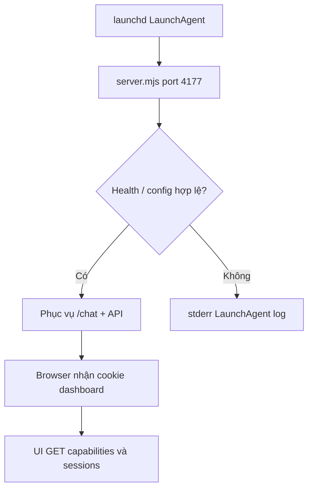
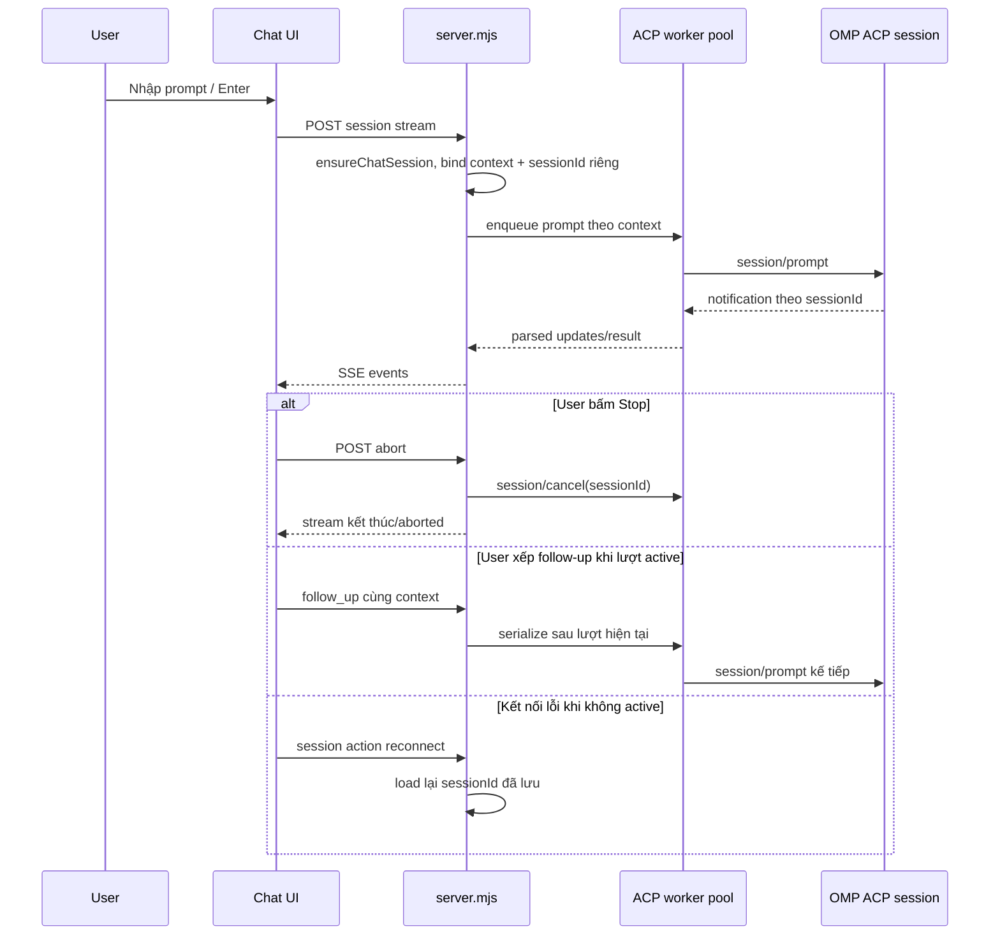
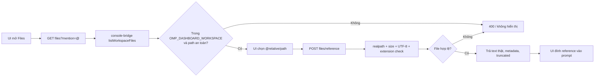
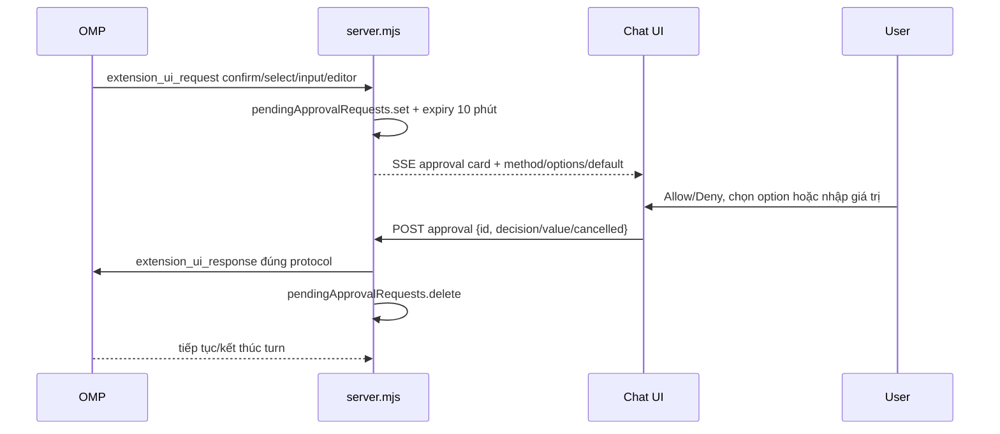
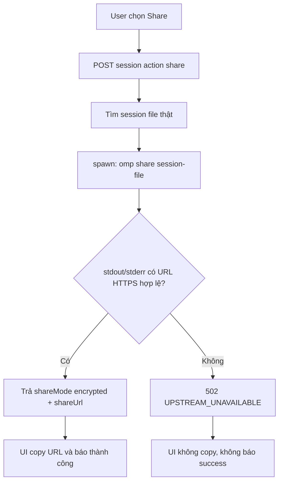
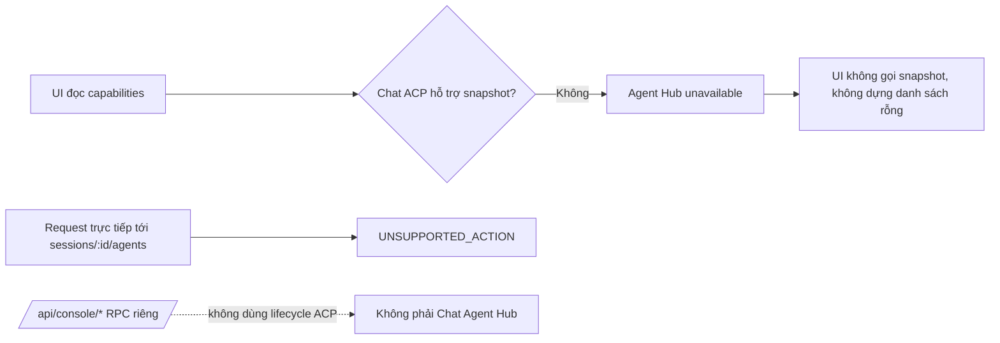
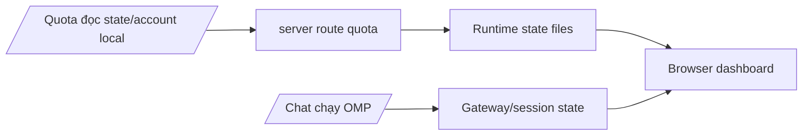

# 03 — Flow end-to-end 🔒

## 1. Khởi động dashboard

`server.mjs` tạo token cookie trong runtime; token không persist vào report hay product release. UI tải capability trước để quyết định control nào enable.

## 2. Prompt streaming, abort, queued follow-up và reconnect

Steer giữa lượt không có trong ACP chuẩn nên capability và API chat báo `unavailable`/`UNSUPPORTED_ACTION`. Follow-up được giữ trong hàng đợi và gửi bằng `session/prompt` riêng sau khi lượt trước kết thúc; không giả lập steer. Reconnect không được chen vào active turn.

## 3. Chọn file thật và đưa vào prompt

Không có upload giả. Nội dung chỉ được đọc từ file thật dưới workspace cấu hình; server hạn chế 512 KiB/file và 200.000 ký tự text trước khi chuyển thành reference. File binary/secret/traversal/symlink escape bị dừng trước khi nội dung tới prompt.

## 4. Native approval roundtrip

UI chỉ là nơi hỏi người dùng, không tự cấp quyền. Approval ID gắn với đúng gateway session; value `select` phải nằm trong options; approval stale hoặc sai session không được coi là đã duyệt.

## 5. Share link

Không dùng local URL `/chat?session=…` làm share success. Chưa tạo share link thật trong đợt kiểm thử vì đó là external side effect.

## 6. Agent Hub

Chat ACP hiện không công bố `get_subagents` snapshot nên capability là `unavailable`; request trực tiếp trả lỗi thay vì thành công với danh sách rỗng. `/api/console/*` giữ RPC riêng, không đổi capability cho Chat.

## 7. Quota dashboard và Chat

Hai vùng dùng chung server local và policy/auth, nhưng nguồn dữ liệu khác nhau: Quota đọc dữ liệu tài khoản/runtime; Chat sử dụng gateway/session OMP. Không để UI suy diễn quota từ một prompt test; đợt này không gửi prompt mới để tránh tiêu quota.

## 8. OMP Chat parity turn flow

Parity chi tiết không nằm trong flow tổng quan này để tránh trộn quota/session/file flow với native turn semantics. Đọc [10 — OMP Chat parity flow & handoff](10-OMP-CHAT-PARITY-FLOW-AND-HANDOFF-IMPORTANT-🔒.md) khi cần:

- phân biệt `agent_end` terminal/non-terminal và `prompt_result` local-only;
- lần theo queue `pendingPrompts` → native `follow_up` → `pendingTurns`;
- kiểm tra RPC v2 negotiation/chunk reassembly;
- kiểm tra approval `confirm/select/input/editor`;
- debug native state projection mà không ghi đè model/thinking của HON PI.

