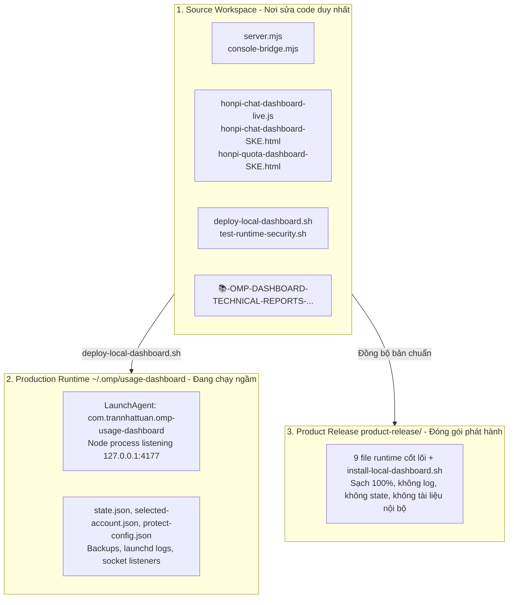

# 07 — Hướng Dẫn Phát Triển, Nâng Cấp & Sổ Tay Dành Cho AI 🔒

**Cập nhật:** 2026-09-23 (Asia/Ho_Chi_Minh)  
**Phạm vi:** Dành cho kỹ sư và AI Agent tiếp nhận dự án Hòn π · OMP Usage Dashboard.  
**Mục tiêu:** Định hình quy trình chỉnh sửa, nâng cấp tính năng, tối ưu hóa token context cho AI, phân định vai trò từng file và cung cấp cẩm nang thao tác nhanh không rủi ro.

---

## 1. Bản đồ ngữ cảnh dành cho AI (AI Reading & Context Guide)

Khi một AI Agent (Claude, Gemini, GPT, OMP) bắt đầu phiên làm việc mới trên dự án này, **tuyệt đối không đọc toàn bộ workspace** (tránh tràn ngữ cảnh >100k tokens và nạp rác từ các prototype cũ). 

### 1.1. Thứ tự đọc bắt buộc (Fast-track 7 file cốt lõi)

```text
1. 00-INDEX-IMPORTANT-🔒.md                     (Nắm trạng thái capability hiện tại)
2. 01-ARCHITECTURE-AND-RUNTIME-IMPORTANT-🔒.md   (Nắm kiến trúc, LaunchAgent, CWD boundary)
3. 06-ADR-CAPABILITY-DECISIONS-IMPORTANT-🔒.md   (Nắm các quyết định và điều luật cấm vi phạm)
4. 10-OMP-CHAT-PARITY-FLOW-AND-HANDOFF-IMPORTANT-🔒.md (Nắm native turn, queue, state và handoff)
5. server.mjs                                    (Backend REST, SSE, Quota, Session)
6. console-bridge.mjs                            (Cầu nối OMP process JSONL, File filter)
7. honpi-chat-dashboard-live.js                  (Logic Frontend Chat, UI State, Event Stream)
```

### 1.2. Bảng phân loại file: Đọc vs Bỏ qua

| File / Thư mục | Trạng thái | Lý do |
|---|---|---|
| `📚-OMP-DASHBOARD-TECHNICAL-REPORTS-.../` | **ĐỌC KHI CẦN** | Bộ tài liệu kiến trúc chuẩn. Đọc `00`, `01`, `06`, `07` và `10` theo task. |
| `10-OMP-CHAT-PARITY-FLOW-AND-HANDOFF-IMPORTANT-🔒.md` | **ĐỌC BẮT BUỘC KHI SỬA PARITY** | Flow native turn, state registry, invariants, verification và rollback boundary của parity pass. |
| `server.mjs` & `console-bridge.mjs` | **ĐỌC BẮT BUỘC** | Trọng tâm logic backend, SSE streaming, authentication, policy. |
| `honpi-chat-dashboard-live.js` | **ĐỌC BẮT BUỘC** | File script frontend chính thức của Chat UI. |
| `honpi-quota-dashboard-SKE.html` | **ĐỌC KHI SỬA QUOTA** | Giao diện Quota Dashboard live. |
| `deploy-local-dashboard.sh` | **ĐỌC KHI DEPLOY** | Script tự động hóa backup, deploy, restart và rollback. |
| `test-runtime-security.sh` | **ĐỌC KHI VERIFY** | Script kiểm tra regression bảo mật và cú pháp. |
| `mock-server.js` & `test-mock-api.js` | **BỎ QUA** (trừ khi test mock) | Test dùng cổng 4178; server chỉ bind `127.0.0.1`, không phát wildcard CORS. Không chạy suite nếu cổng đang có service khác. |
| `HONPI-console-chat-dashboard.html` | **KHÔNG ĐỌC** | Prototype cũ (5.5 MB), gây tràn bộ nhớ context. |
| `design-system.html` | **KHÔNG ĐỌC** | File tham khảo giao diện (7.8 MB), không chứa logic nghiệp vụ. |
| `Chat chuẩn/` & các HTML cũ khác | **KHÔNG ĐỌC** | Bản nháp thiết kế trong quá khứ, đã được chuẩn hóa vào file `-SKE.html`. |
| `~/.omp/usage-dashboard/state.json`... | **KHÔNG ĐỌC VÀO GIT** | File runtime nhạy cảm, chứa trạng thái cá nhân cục bộ. |

---

## 2. Phân định vai trò các vùng & tệp tin (Component Roles)

Dự án được phân tách thành 3 vùng ranh giới nghiêm ngặt:



### Chi tiết vai trò:
1. **Source Workspace (`/Users/trannhattuan/Documents/CODE/OMP GEMINI Dashboad - Chat UI`)**:
   - Nguồn sự thật duy nhất (Single Source of Truth - SSOT) cho toàn bộ mã nguồn.
   - Mọi thao tác chỉnh sửa, refactor, thêm tính năng bắt buộc phải thực hiện tại đây.
2. **Runtime Production (`~/.omp/usage-dashboard`)**:
   - Vùng thực thi do LaunchAgent `com.trannhattuan.omp-usage-dashboard` duy trì trên cổng `4177`.
   - **Tuyệt đối không sửa code trực tiếp tại đây**. Mọi thay đổi phải đi qua `deploy-local-dashboard.sh`.
3. **Product Release (`product-release/`)**:
   - Thư mục chứa gói phát hành sạch cho người dùng khác.
   - Chỉ chứa mã nguồn chạy được và script cài đặt `install-local-dashboard.sh`, loại bỏ toàn bộ dữ liệu máy cá nhân.

---

## 3. Quy trình chỉnh sửa & nâng cấp chuẩn (Workflow 3 bước)

Để đảm bảo tốc độ nhanh nhất, không gây drift code và có bảo hiểm rollback 100%, tuân thủ đúng 3 bước:

```text
[Bước 1: Chỉnh sửa] ───> [Bước 2: Triển khai 1 chạm] ───> [Bước 3: Kiểm chứng]
```

### Bước 1: Sửa code tại Workspace
- Sửa backend: `server.mjs` hoặc `console-bridge.mjs`.
- Sửa giao diện: `honpi-chat-dashboard-live.js` hoặc file HTML tương ứng.

### Bước 2: Triển khai tự động bằng 1 lệnh
Chạy từ thư mục gốc của workspace:
```bash
./deploy-local-dashboard.sh --restart
```
Lệnh này sẽ tự động:
1. Tạo snapshot backup nguyên trạng vào `~/.omp/usage-dashboard/backups/deploy/YYYYMMDD-HHMMSS`.
2. Kiểm tra cú pháp `node --check`.
3. Đồng bộ file sang `~/.omp/usage-dashboard/`.
4. Ra lệnh `launchctl kickstart` khởi động lại tiến trình Node.
5. Thăm dò `GET http://127.0.0.1:4177/healthz` đảm bảo runtime đã sẵn sàng phục vụ.

### Bước 3: Kiểm chứng & Rollback nếu có lỗi
- Chạy kiểm tra tĩnh:
  ```bash
  ./test-runtime-security.sh
  ```
- Kiểm tra trạng thái listener:
  ```bash
  lsof -nP -iTCP:4177 -sTCP:LISTEN
  ```
- **Nếu phát sinh lỗi nghiêm trọng:** Rollback ngay lập tức về backup vừa tạo:
  ```bash
  ./deploy-local-dashboard.sh --rollback ~/.omp/usage-dashboard/backups/deploy/<TIMESTAMP>
  ```

---

## 4. Hướng dẫn nâng cấp các Capability còn `partial`

Tuân thủ nghiêm ngặt **ADR-01 (Zero Fake Success)**: Chỉ chuyển trạng thái từ `partial` sang `supported` trong `00-INDEX` và `/api/v1/omp/capabilities` khi có bằng chứng thực nghiệm (live evidence).

### 4.1. Nâng cấp Stream Recovery (`partial` $\rightarrow$ `supported`)
- **Hiện trạng:** Đã có backend adapter cho `abort` (POST `/api/v1/sessions/:id/abort`) và `reconnect` (POST `/api/v1/sessions/:id/action` với `{action: "reconnect"}`).
- **Yêu cầu nâng cấp:**
  1. Trong `honpi-chat-dashboard-live.js`, bắt sự kiện `onerror` hoặc `onclose` của SSE EventSource / fetch stream.
  2. Hiển thị UI Toast thông báo đứt kết nối và nút "Khôi phục phiên (Reconnect)".
  3. Khi bấm Reconnect, gọi API reconnect và fetch lại transcript qua `GET /api/v1/sessions/:id/messages`.
  4. Xác nhận bất biến ADR-03: Không cho phép reconnect khi session đang có lượt chat đang active.

### 4.2. Nâng cấp Agent Hub (`partial` $\rightarrow$ `supported`)
- **Hiện trạng:** Backend đã lấy được snapshot thật qua `get_subagents` từ OMP RPC, hiển thị danh sách subagents read-only.
- **Yêu cầu nâng cấp:**
  1. Khi OMP phát sinh subagent chạy ngầm (ví dụ khi gọi tool `task`), kiểm tra event frame để cập nhật danh sách tức thì trên giao diện.
  2. Chưa hỗ trợ thao tác điều khiển (pause/kill subagent) do OMP RPC chưa công bố contract điều khiển này $\rightarrow$ Giữ các nút điều khiển ở trạng thái `disabled` kèm tooltip "Đang chờ OMP API".

### 4.3. Nâng cấp Share Link (`partial` $\rightarrow$ `supported`)
- **Hiện trạng:** Backend `runOmpShare` spawn `omp share <session-file>` với timeout 30s.
- **Yêu cầu nâng cấp:**
  1. Chỉ hiển thị popup thành công và copy vào clipboard khi kết quả trả về đúng regex `^https://[a-zA-Z0-9.-]+\.[a-zA-Z]{2,}/.*`.
  2. Bất kỳ mã lỗi nào (timeout 30s, OMP trả lỗi không chia sẻ được) phải render lỗi `502 Upstream Share Failed`. Tuyệt đối không fallback sang loopback URL `http://127.0.0.1:4177/chat?session=...`.

---

## 5. Sổ tay tra cứu lệnh vận hành nhanh (Cheat Sheet)

```bash
# 1. Khởi động lại service qua LaunchAgent
launchctl kickstart -k gui/$(id -u)/com.trannhattuan.omp-usage-dashboard

# 2. Kiểm tra tiến trình đang chạy và cổng 4177
lsof -nP -iTCP:4177 -sTCP:LISTEN
launchctl print gui/$(id -u)/com.trannhattuan.omp-usage-dashboard

# 3. Xem log hoạt động trực tiếp của server
tail -f ~/.omp/usage-dashboard/server.log
# hoặc nếu launchd redirect:
tail -f ~/.omp/usage-dashboard/launchd.log ~/.omp/usage-dashboard/launchd.error.log

# 4. Kiểm tra Health & Security smoke
curl -fsS http://127.0.0.1:4177/healthz
cd "/Users/trannhattuan/Documents/CODE/OMP GEMINI Dashboad - Chat UI" && ./test-runtime-security.sh

# 5. Chạy test mock API (12 kịch bản / 267 kiểm tra; cổng 4178 trống)
rtk node test-mock-api.js

# 6. Kiểm tra phiên bản OMP binary đang liên kết
~/.bun/bin/omp --version
```

---

## 6. Checklist an toàn trước khi kết thúc phiên làm việc

- [ ] Đã chạy `node --check server.mjs` và `node --check console-bridge.mjs` không có lỗi cú pháp.
- [ ] Đã chạy `./test-runtime-security.sh` và nhận kết quả `pass`.
- [ ] Không có file nhạy cảm (`state.json`, `selected-account.json`, token, credentials, session logs) bị di chuyển ra ngoài thư mục `~/.omp/usage-dashboard/`.
- [ ] Cổng `127.0.0.1:4177` chỉ có đúng 1 tiến trình Node duy nhất lắng nghe.
- [ ] File backup mới nhất đã được lưu lại trong `~/.omp/usage-dashboard/backups/`.
- [ ] Không tự ý commit vào Git root cha `/Users/trannhattuan/Documents`.
