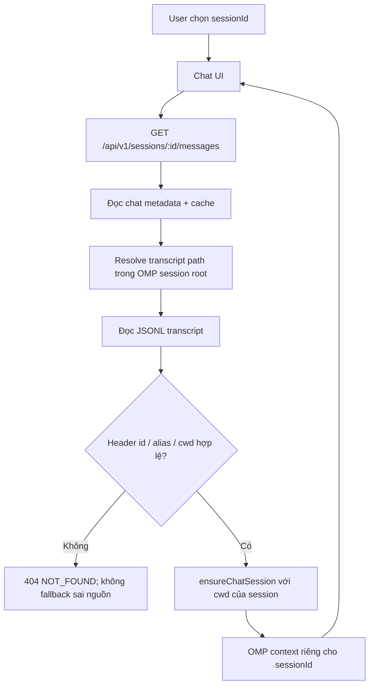

# 08 — Session isolation và cross-project data boundary 🔒

**Trạng thái:** Accepted / deployed locally  
**Ngày:** 2026-09-24 10:04:41 +0700  
**Phạm vi:** `server.mjs`, `console-bridge.mjs`, session transcript, workspace file reference và runtime local tại port `4177`.  
**Mức độ:** Critical security boundary.

> Báo cáo không chứa token, cookie, credential, log hội thoại hoặc nội dung prompt thật. Chỉ ghi contract, đường dẫn code, flow và bằng chứng đã kiểm tra.

## 1. Mục tiêu và threat model

Mục tiêu là bảo đảm một cuộc trò chuyện chỉ được dùng:

1. transcript của chính session đó;
2. OMP context của chính session đó;
3. file nằm trong project `cwd` của session đó;
4. cache/event/request có cùng `sessionId`.

Các lỗi cần chặn:

- Session ở project A nhìn thấy file của project B.
- Session A đọc transcript của session B do metadata/path trỏ nhầm.
- Transcript sai nguồn bị fallback thành cache rỗng hoặc cache không đúng session.
- Session mới hoặc session chưa phân loại được nạp lại nội dung trò chuyện cũ.

## 2. Nguyên nhân gốc đã phát hiện

### 2.1 Workspace root dùng biến global

`console-bridge.mjs` từng lấy workspace root từ:

```js
process.env.OMP_DASHBOARD_WORKSPACE || context.cwd
```

LaunchAgent hiện cấu hình `OMP_DASHBOARD_WORKSPACE` là project Dashboard. Trước đây, dùng biến này làm root toàn cục khiến file picker/reference trỏ sai project; Decision A đã sửa để các thao tác đó luôn lấy `context.cwd`. Với chat generic mới, CWD mặc định riêng là General (mục 2.2); cấu hình cũ không còn khiến chat mới bắt đầu ở repo Dashboard.

### 2.2 Workspace General cho chat chưa phân loại

`POST /api/v1/sessions` dùng CWD theo thứ tự: project `folderId`, workspace chat chỉ định, rồi `OMP_DASHBOARD_GENERAL_WORKSPACE` (mặc định `~/Documents/OMP General Chat`). Thư mục General được tạo lười với quyền `0700` nếu chưa tồn tại. Thiếu `folderId` vẫn giữ chat ở nhóm chưa phân loại; gán folder về sau không đổi CWD.

`OMP_DASHBOARD_WORKSPACE` vẫn là fallback tương thích cho luồng khôi phục/migration session cũ, không còn là workspace mặc định cho chat generic mới. CWD chọn OMP context và file picker/reference; CWD không phải sandbox cấp hệ điều hành, quyền truy cập lệnh vẫn theo OMP approval mode.

### 2.3 Transcript source chưa được ràng buộc đủ chặt

Đường dẫn JSONL được resolve từ metadata/session cache. Nếu path bị lệch nguồn, việc chỉ kiểm tra file tồn tại không đủ để chứng minh file đó thuộc session đang yêu cầu. Fallback cache trong trường hợp source mismatch có thể che giấu lỗi ranh giới dữ liệu.

## 3. Quyết định bảo mật

### Decision A — Workspace luôn lấy từ context của session

`listWorkspaceFiles()` và `readWorkspaceFile()` dùng:

```js
const root = await realpath(context.cwd)
```

`listWorkspaceFiles()` và `readWorkspaceFile()` dùng `const root = await realpath(context.cwd)`, không dùng biến môi trường global để thay thế CWD session. Chat generic mới dùng `OMP_DASHBOARD_GENERAL_WORKSPACE` (mặc định `~/Documents/OMP General Chat`); workspace đã chọn được lưu theo chat, còn project `folderId` luôn dùng CWD của project. `OMP_DASHBOARD_WORKSPACE` chỉ còn làm fallback tương thích cho session cũ/migration. CWD là context/file-picker root, không phải sandbox OS; lệnh vẫn chịu OMP permission mode.

### Decision B — Transcript phải pass source binding trước khi trả dữ liệu

Sau khi parse JSONL, server kiểm tra:

- header session id khớp route `sessionId`, hoặc khớp `ompSessionId` hợp lệ;
- legacy alias chỉ được chấp nhận khi metadata hiện tại là owner duy nhất của path;
- `cwd` trong transcript và `cwd` của metadata/cache phải cùng canonical path;
- mismatch trả lỗi `NOT_FOUND`/HTTP `404`;
- source mismatch không được rơi vào cache fallback.

Cách này ưu tiên không trả dữ liệu hơn là cố khôi phục một transcript không chứng minh được nguồn.

### Decision C — Giữ cách ly theo session đã có

Các boundary hiện hữu tiếp tục được giữ:

- `gatewaySessions` keyed by `sessionId`;
- `chatMessageCache` keyed by `sessionId`;
- `activeChatRequests` lưu `sessionId` và `contextId`;
- prompt stream kiểm tra active session trước khi ghi delta/message;
- UI chỉ render khi `state.activeId === sessionId`;
- Safety Guard giới hạn một turn đang chạy, nhưng đây là giới hạn quota/concurrency, không phải vùng chia sẻ transcript.

## 4. Flow cách ly dữ liệu

### 4.1 Chọn hoặc khôi phục một session



### 4.2 Liệt kê file trong project

```mermaid
flowchart LR
  UI[Files picker của session A] --> API[GET /api/v1/sessions/A/files?mention=@]
  API --> CTX[ConsoleContext A]
  CTX --> ROOT[realpath(contextA.cwd)]
  ROOT --> LIST[listWorkspaceFiles]
  LIST --> GUARD{File nằm dưới root A?}
  GUARD -- Không --> DROP[Không hiển thị]
  GUARD -- Có --> RESULT[Trả relative path của project A]

  B[Session B] --> ROOTB[realpath(contextB.cwd)]
  ROOTB -. Không dùng chung root với A .-> LISTB[listWorkspaceFiles B]
```

### 4.3 Đọc file reference vào prompt

```mermaid
sequenceDiagram
  participant UI as Chat UI
  participant S as server.mjs
  participant C as ConsoleContext(sessionId)
  participant FS as console-bridge.mjs

  UI->>S: POST /api/v1/sessions/:id/files/reference
  S->>C: ensureChatSession(id)
  S->>FS: readWorkspaceFile(C, relativePath)
  FS->>FS: realpath(C.cwd)
  FS->>FS: resolve + realpath(target)
  alt target ngoài project, component bị cấm hoặc path không hợp lệ
    FS-->>S: FORBIDDEN / BAD_REQUEST
    S-->>UI: 403/400; không có nội dung file
  else target thuộc project
    FS-->>S: UTF-8 content + metadata
    S-->>UI: reference bounded theo size/length guard
  end
```
Danh sách autocomplete và đọc reference cùng áp denylist lên mọi component của đường dẫn, gồm cả directory. Gõ trực tiếp `@secrets/` không liệt kê nội dung; tham chiếu trực tiếp tới `secrets/config.json` bị từ chối trước khi đọc file.

### 4.4 Ghi và đọc transcript

```mermaid
flowchart TD
  P[Prompt của session A] --> R[activeChatRequests: A + contextA]
  R --> O[OMP contextA]
  O --> D[Delta/tool/final events]
  D --> CACHE[chatMessageCache[A]]
  D --> FILE[Transcript path của A]
  READ[GET messages/A] --> CHECK[Source binding]
  CHECK -->|id + owner + cwd đúng| OUT[Trả messages của A]
  CHECK -->|lệch bất kỳ boundary nào| STOP[404; không trả cache/path của B]
```

## 5. Invariants bắt buộc

| Invariant | Ý nghĩa | Lỗi khi vi phạm |
|---|---|---|
| `context.cwd` là workspace root | File picker/reference bám theo context, không đổi sang root global | Không được dùng global workspace override |
| Transcript header/path/metadata cùng nguồn | Không đọc nhầm JSONL | `404 NOT_FOUND` |
| Canonical `cwd` phải khớp | Không dùng transcript project khác | `404 NOT_FOUND` |
| Cache key gồm `sessionId` | Delta/message không trộn session | Bỏ event hoặc trả lỗi |
| Context map key gồm `sessionId` | OMP process/context tách nhau | Không reuse context khác session |
| UI active id phải khớp response | Không render response cũ vào session mới | Bỏ response stale |
| New draft bắt đầu rỗng | Không nạp transcript cũ khi chưa gửi prompt | `activeId=null`, message count 0 |

## 6. Ma trận lỗi và hành vi fail-closed

| Tình huống | Kết quả bắt buộc |
|---|---|
| File traversal hoặc target ngoài project | `400` hoặc `403`, không trả nội dung |
| Session A yêu cầu file chỉ có trong project B | `403 FORBIDDEN` |
| Transcript path không thuộc owner duy nhất | `404 NOT_FOUND` |
| JSONL header id không khớp và không có alias hợp lệ | `404 NOT_FOUND` |
| Transcript `cwd` khác metadata `cwd` | `404 NOT_FOUND` |
| Không tìm thấy transcript nhưng có cache cùng session | Được dùng cache cùng `sessionId` |
| Source mismatch nhưng có cache | Không dùng cache; trả `404` |
| Chuyển session khi stream cũ còn active | UI không render stale response; Safety Guard giữ concurrency 1 |

## 7. Bằng chứng kiểm thử

### 7.1 Contract/regression test

Lệnh:

```sh
rtk node test-session-actions.mjs
```

Kết quả: **28 scenarios passed** trên isolated port.

Hai kiểm tra quan trọng được thêm:

1. Session ở `other-project` chỉ thấy `@other.txt`, không thấy `@src/`; đọc file project khác trả `403`.
2. Metadata của session A bị trỏ tới transcript project B với `cwd` A; endpoint messages trả `404`, không trả nội dung B.

Syntax đã kiểm tra:

```sh
rtk node --check server.mjs
rtk node --check console-bridge.mjs
rtk node --check test-session-actions.mjs
```

### 7.2 Production smoke sau deploy

Deploy:

```sh
rtk ./deploy-local-dashboard.sh --restart
```

Health và runtime source/deployed đều pass:

```text
GET http://127.0.0.1:4177/healthz -> {"ok":true}
server.mjs       source == runtime
console-bridge.mjs source == runtime
```

Live cross-project check:

- Session `Open design` giữ đúng message/title/workspace của Open design.
- Session Dashboard giữ đúng message/title/workspace của Dashboard.
- Open design đọc file Dashboard `@honpi-chat-dashboard-live.js`: `403 FORBIDDEN`.
- Dashboard đọc cùng file: `200`.
- Tạo draft mới: `activeId=null`, `messageCount=0`, không phát sinh `POST /api/v1/sessions`.
- Không gửi prompt thật, không tạo share link, không thay đổi transcript người dùng trong smoke test.

## 8. Vận hành và rollback

### Sau mỗi thay đổi boundary

1. Sửa source `server.mjs`/`console-bridge.mjs`.
2. Chạy syntax check.
3. Chạy `rtk node test-session-actions.mjs`.
4. Deploy bằng `deploy-local-dashboard.sh --restart` để tự tạo backup.
5. Kiểm tra `/healthz`.
6. Kiểm tra một session ở project A và một session ở project B.
7. Kiểm tra file reference sai project trả `403`.

### Backup deploy đã tạo

```text
/Users/trannhattuan/.omp/usage-dashboard/backups/deploy/20260924-095928
```
### Backup độc lập của báo cáo này

```text
/Users/trannhattuan/.omp/usage-dashboard/backups/session-isolation/20260924-100441/08-SESSION-ISOLATION-AND-CROSS-PROJECT-SECURITY-IMPORTANT-🔒.md
```

Checksum SHA-256 được lưu trong `BACKUP-MANIFEST.txt` cùng thư mục backup.

### Quy tắc rollback

- Chỉ khôi phục đúng file runtime cần rollback.
- Không dùng `git reset --hard`.
- Không xóa `~/.omp/agent`, transcript, database hoặc credential store.
- Sau rollback phải chạy health và regression test trước khi dùng lại dashboard.

## 9. Phạm vi chưa thay đổi

- `OMP_DASHBOARD_WORKSPACE` vẫn là default project cho session mới khi UI không truyền `cwd`; điều này không nạp transcript cũ, nhưng session mới vẫn có thể đọc file của default project nếu người dùng chủ động reference file.
- Nếu cần session mới hoàn toàn trung tính, phải thiết kế thêm `neutral workspace` hoặc bắt buộc chọn project trước prompt. Đây là quyết định sản phẩm riêng, không tự thay đổi trong bản hardening này.
- Account/provider OAuth có thể dùng chung ở tầng runtime; đó là credential routing, không phải chia sẻ transcript/context giữa session.

## 10. Quy tắc không được vi phạm lại

- Không khôi phục `process.env.OMP_DASHBOARD_WORKSPACE` làm override cho `context.cwd`.
- Không trả transcript chỉ vì path tồn tại.
- Không nuốt `sourceMismatch` rồi trả cache rỗng/khác nguồn.
- Không dùng key cache/context thiếu `sessionId`.
- Không đưa transcript, log, token, cookie hoặc backup runtime vào `product-release`/GitHub.

**Kết luận:** boundary workspace và transcript hiện đã được ràng buộc theo session/project; lỗi cross-project đã có regression test và đã kiểm tra trên runtime production local.