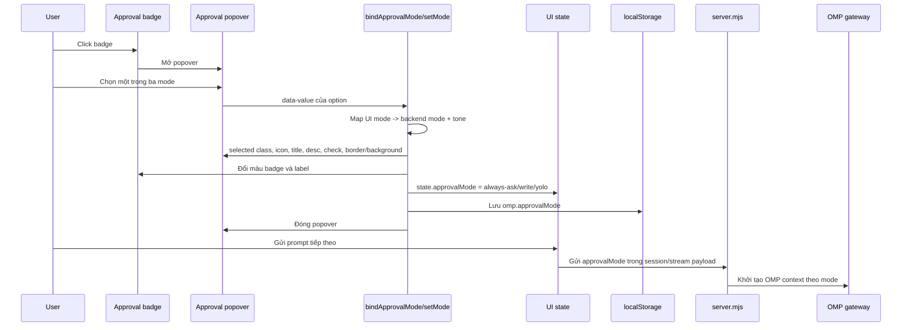

# 09 — Approval mode palette và flow vận hành 🔒

**Cập nhật:** 2026-09-24 (Asia/Ho_Chi_Minh)  
**Phạm vi:** Chat UI production local tại `http://127.0.0.1:4177/chat`.  
**Mục tiêu:** phân biệt rõ ba chế độ phê duyệt bằng màu riêng, đồng thời lưu flow từ thao tác chọn chế độ đến approval request thật của OMP.

> Tài liệu nội bộ. Không chứa token, cookie, prompt thật, nội dung session, credential hoặc dữ liệu quota.

## 1. Vấn đề trước khi sửa

Ba lựa chọn trong approval popover dùng chung cảm giác màu vàng/cam. Nguyên nhân chính:

1. `fullAccessBadge` được khởi tạo bằng inline style của legacy surface với `var(--warn)`.
2. `bindApprovalMode()` của live surface chỉ đổi class `selected`, chưa reset màu inline từ legacy.
3. CSS cũ chỉ có màu semantic riêng cho `.is-full-access.selected`; hai mode còn lại rơi về màu foreground mặc định.
4. Khi người dùng chuyển mode, badge phía composer có thể giữ tone vàng của mode `full_access` dù state backend đã đổi.

Hậu quả: người dùng khó nhận biết nhanh đang ở `always-ask`, `write` hay `yolo`; màu không phản ánh mức quyền.

## 2. Quyết định thiết kế

| UI mode | Backend mode | Nhãn | Màu semantic | Ý nghĩa |
|---|---|---|---|---|
| `require_approval` | `always-ask` | Yêu cầu phê duyệt | `var(--accent)` — xanh dương | Luôn hỏi trước thao tác cần approval |
| `approve_for_me` | `write` | Phê duyệt giúp tôi | `var(--success)` — xanh lá | Chỉ hỏi thao tác có thể không an toàn |
| `full_access` | `yolo` | Toàn quyền truy cập | `var(--warn)` — vàng/cam | Không giới hạn theo policy hiện tại |

Mỗi màu được dùng nhất quán cho:

- Option đang chọn trong popover.
- Icon mode.
- Tiêu đề mode.
- Mô tả mode.
- Dấu check.
- Badge mode ở composer.
- Border/background nhẹ của vùng selected.

Màu chỉ biểu thị state UI; quyền thật vẫn do backend/OMP `approvalMode` quyết định.

## 3. File và symbol chịu trách nhiệm

| Thành phần | File | Symbol / vùng |
|---|---|---|
| Palette + mapping UI/backend | `honpi-chat-dashboard-live.js` | `bindApprovalMode()`, `modes`, `modeTones` |
| Áp màu selected/badge | `honpi-chat-dashboard-live.js` | `setMode()` |
| Style nền popover | `honpi-chat-dashboard-SKE.html` | `.approval-popover`, `.approval-option-item` |
| Legacy compatibility surface | `honpi-chat-dashboard-legacy.js` | `setPermissionMode()` |
| Backend capability contract | `server.mjs` | `OMP_APPROVAL_MODES` |
| Production runtime | `~/.omp/usage-dashboard/` | bản đã deploy từ source workspace |

Thay đổi chính nằm ở live adapter: `modeTones` là nguồn mapping màu và `setMode()` reset style của option không được chọn, tránh giữ lại inline style từ mode trước.

## 4. Flow chọn approval mode



### Mapping bắt buộc

```text
require_approval -> always-ask
approve_for_me  -> write
full_access     -> yolo
```

UI không tự cấp quyền. Nó chỉ đồng bộ lựa chọn; OMP và `server.mjs` vẫn là nguồn sự thật cho policy.

## 5. Flow approval request có timeout

Palette chỉ là lớp hiển thị mode. Với command approval thật, flow runtime vẫn đi qua approval boundary:

```mermaid
sequenceDiagram
  participant O as OMP tool
  participant S as server.mjs
  participant UI as Chat UI
  participant U as User

  O->>S: extension_ui_request confirm/select
  S->>S: Tạo pendingApprovalRequests + expiresAt 10 phút
  S-->>UI: SSE approval payload
  UI->>UI: Render card + countdown mm:ss
  U->>UI: Cho phép hoặc Từ chối
  UI->>S: POST /sessions/:id/approval
  alt Còn hiệu lực
    S->>O: extension_ui_response theo decision
    S-->>UI: Kết thúc card/request
  else Hết hạn
    UI->>UI: Hiển thị Đã hết thời gian, disable buttons
    S->>O: Gửi cancel; select không tự chọn option khi hết hạn
    S-->>UI: Không chấp nhận decision stale
  end
```

Invariant:

- Approval ID phải thuộc đúng session.
- Decision stale hoặc sai session trả `NOT_FOUND`; không tự approve.
- Select hết hạn gửi cancel, không chọn `denyValue` hay option bất kỳ.
- Countdown chỉ hiện khi payload có `expiresAt` hoặc `timeoutMs`.
- Hết hạn không cho phép click lại.
- Màu mode không thay đổi policy backend.

## 6. Kiểm chứng production

Đã kiểm tra trực tiếp trên `/chat` sau deploy:

| Mode | Observed selected color |
|---|---|
| `require_approval` | xanh accent, computed `oklch(0.68 0.19 255)` |
| `approve_for_me` | xanh success, computed `rgb(16, 185, 129)` |
| `full_access` | vàng/cam warning, computed `rgb(245, 158, 11)` |

Các trạng thái đều kiểm tra trên cả option selected và badge composer. Screenshot production đã xác nhận mode `Phê duyệt giúp tôi` hiển thị xanh lá thay vì vàng.

Focused checks:

```sh
node --check honpi-chat-dashboard-live.js
node --check honpi-chat-dashboard-legacy.js
```

Các check đều pass. Runtime đã được deploy bằng `deploy-local-dashboard.sh`; setting người dùng được khôi phục về `Phê duyệt giúp tôi` sau QA.

## 7. Backup và rollback

Backup chuẩn phải được tạo sau khi source/report hoàn tất:

```sh
cd '/Users/trannhattuan/Documents/CODE/OMP GEMINI Dashboad - Chat UI'
./deploy-local-dashboard.sh
```

Script tạo backup timestamped dưới:

```text
/Users/trannhattuan/.omp/usage-dashboard/backups/deploy/<YYYYMMDD-HHMMSS>/
```
Backup đã tạo cho bước này:

```text
/Users/trannhattuan/.omp/usage-dashboard/backups/deploy/20260924-101213/
```

Report này và file index đã được copy vào backup trên; `cmp` và SHA-256 đều đã kiểm tra.

Backup gồm source runtime, LaunchAgent nếu có, checksum và listener/launchctl snapshot. Rollback an toàn:

```sh
./deploy-local-dashboard.sh --rollback '/Users/trannhattuan/.omp/usage-dashboard/backups/deploy/<YYYYMMDD-HHMMSS>'
```

Sau rollback phải kiểm tra:

```sh
curl -fsS http://127.0.0.1:4177/healthz
node --check '/Users/trannhattuan/.omp/usage-dashboard/server.mjs'
```

Không dùng `git reset --hard`, không xóa `~/.omp`, không copy chéo runtime state/session vào source release.

## 8. Phạm vi không thay đổi

- Không đổi backend approval policy.
- Không đổi mapping `always-ask` / `write` / `yolo`.
- Không thêm account rotation, retry hoặc provider fallback.
- Không đưa token, cookie, session log hoặc runtime state vào tài liệu/backup source.
