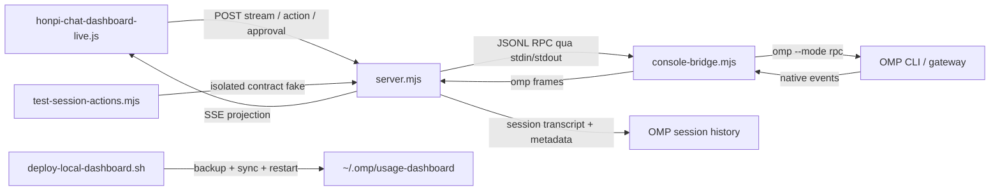
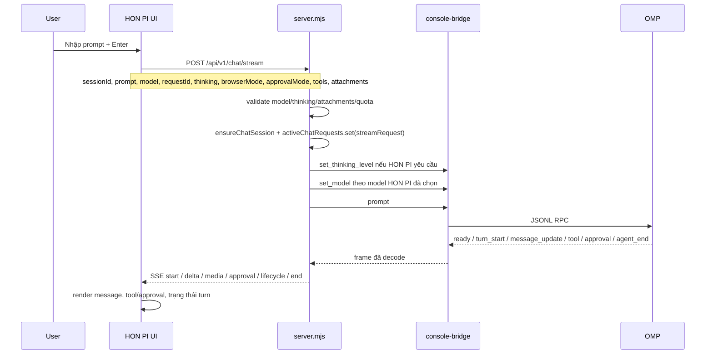
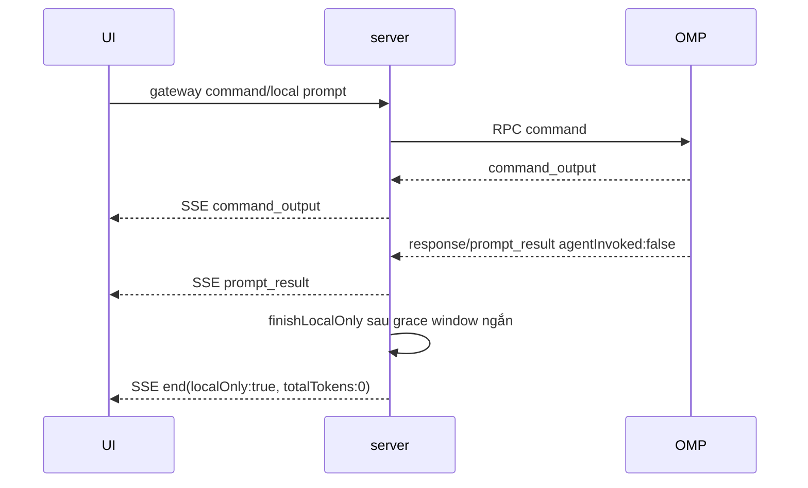
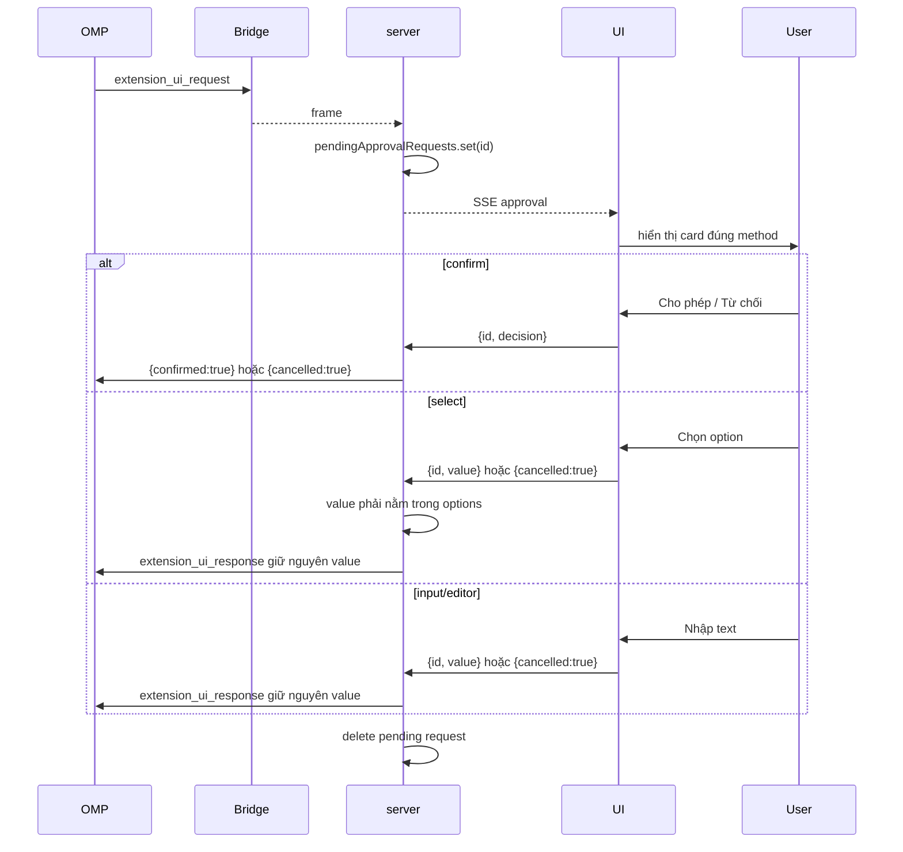

# 10 — OMP Chat Logic Parity: Flow, State & Handoff 🔒

**Cập nhật:** 2026-09-24 (Asia/Ho_Chi_Minh)  
**Phạm vi:** HON PI · OMP Usage Dashboard, đợt `OMP Logic Parity Pass`.  
**Mục đích:** tài liệu truy vết để người hoặc AI tiếp nhận có thể hiểu flow, suy luận lỗi, kiểm tra regression và rollback mà không phải đọc lại toàn bộ phiên chat.

> Tài liệu nội bộ. Không chứa token, cookie, API key, session log, prompt thật hoặc nội dung phiên thật. Mọi kết luận bên dưới phân biệt rõ bằng chứng đã kiểm tra và phần chưa chạy có chủ đích.

---

## 1. Tóm tắt điều hành

### Trạng thái hiện tại

- Đã đồng bộ các phần logic native OMP còn thiếu trong Chat UI.
- **Model và thinking level vẫn tách riêng theo HON PI**, không bị native state OMP ghi đè.
- Queue khi đang có turn active dùng native `follow_up`, không mở stream thứ hai.
- RPC v2 chunk, protocol negotiation, terminal semantics, command output, prompt result và approval roundtrip đã có contract test.
- Chat Body parity mới project thinking, todo, tool, tool result, command/status activity vào một nhóm hoạt động gọn theo assistant turn; status lặp được aggregate, tool/result ghép theo call, summary chỉ giữ `OMP · số sự kiện · trạng thái`, loading status dùng accent theme khi chờ và câu trả lời cuối vẫn nằm ngoài toggle.
- Session switch khi order đang chạy hoặc prompt đầu tiên chưa được OMP nhận giữ DOM in-flight theo từng session bằng cache tạm volatile, rebind generation của request khi quay lại; khi stream kết thúc thì cache bị invalid và tải transcript cuối từ API.
- First prompt của session mới tạo chạy trực tiếp sau khi tạo session, không vào `pendingPrompts`; prompt thứ hai trong lúc session bootstrap mới được queue và gắn vào session sau đó.
- Khi session A còn active và có order chờ, mở session B không bị chặn; prompt của B được queue riêng theo B, FIFO được giữ, queue của A không bị gửi chéo; khi lượt A kết thúc dispatcher tiếp tục drain session đang chọn.
- Session isolation và cross-project boundary của đợt trước vẫn được giữ nguyên.
- Production đã deploy qua script có backup rollback.

### Phạm vi không đổi

- Không chạy prompt thật trên production trong đợt này để tránh quota và external side effect.
- Không thay đổi chiến lược model/thinking hiện tại của HON PI.
- Không biến các capability chưa có adapter thật thành `supported`.
- Không sửa trực tiếp code trong `~/.omp/usage-dashboard`; source workspace vẫn là nguồn sự thật.

### Vị trí vận hành

| Vùng | Đường dẫn / địa chỉ | Vai trò |
|---|---|---|
| Source workspace | `/Users/trannhattuan/Documents/CODE/OMP GEMINI Dashboad - Chat UI` | Nơi duy nhất được sửa code |
| Runtime | `/Users/trannhattuan/.omp/usage-dashboard` | Bản đang chạy bởi LaunchAgent |
| Dashboard | `http://127.0.0.1:4177/chat` | UI live |
| Health | `http://127.0.0.1:4177/healthz` | Kiểm tra service |
| LaunchAgent | `com.trannhattuan.omp-usage-dashboard` | Giữ Node server chạy |
| Backup parity gần nhất | `/Users/trannhattuan/.omp/usage-dashboard/backups/deploy/20260924-160840` | Điểm rollback đã tạo |

---

## 2. Bản đồ thành phần và trách nhiệm



| Thành phần | Trách nhiệm cần nhớ |
|---|---|
| `honpi-chat-dashboard-live.js` | UI state, prompt stream, queue, approval card, session selection và native state projection |
| `server.mjs` | REST/SSE boundary, validation, active request registry, session binding, event projection, approval routing |
| `console-bridge.mjs` | Spawn OMP, JSONL framing, RPC v2 reassembly, Safety Guard, active-turn lifecycle |
| `test-session-actions.mjs` | Contract test cô lập, không dùng quota thật |
| `test-runtime-security.sh` | Static/runtime security smoke và guard chống drift |
| `deploy-local-dashboard.sh` | Tạo backup, kiểm tra cú pháp, copy sang runtime, restart LaunchAgent, health check |
| `03-END-TO-END-FLOWS-IMPORTANT-🔒.md` | Flow dashboard tổng quát; tài liệu này đi sâu riêng vào parity turn |
| `08-SESSION-ISOLATION-AND-CROSS-PROJECT-SECURITY-IMPORTANT-🔒.md` | Boundary session/CWD/cross-project đã hoàn tất trước parity pass |

---

## 3. Flow A — Chọn session và nạp state

```mermaid
sequenceDiagram
  participant U as User
  participant UI as HON PI UI
  participant S as server.mjs
  participant O as OMP transcript

  U->>UI: Chọn session
  UI->>UI: Tăng generation/guard, reset nativeState nếu đổi session
  par Nạp nội dung
    UI->>S: GET /api/v1/sessions/:id/messages
    S->>O: Đọc transcript đúng session + CWD
    O-->>S: messages đã lọc
    S-->>UI: messages
  and Nạp native projection
    UI->>S: GET /api/v1/sessions/:id/state
    S->>S: chatSessionNativeState()
    S->>O: get_state nếu gateway đang live
    O-->>S: native status/settings/message count
    S-->>UI: nativeState an toàn
  end
  UI->>UI: Chỉ gắn nativeState; không ghi đè activeModel/thinking
```

### Bất biến

1. `state.nativeState` bị reset khi đổi session hoặc về selection rỗng.
2. Response cũ không được ghi vào session mới: mọi cập nhật sau `await` phải qua guard hiện tại.
3. Native state là projection quan sát, không phải nguồn điều khiển model/thinking của HON PI.
4. State trả về browser không chứa `cwd`, đường dẫn transcript hoặc runtime secret.
5. Session transcript phải khớp một trong các điều kiện: header ID đúng, alias metadata duy nhất hoặc cached canonical path hợp lệ; CWD canonical phải khớp.

### Field native state

```text
sessionId       ID gateway của session
nativeSessionId ID OMP nếu transcript có alias
settingsSource  luôn là "omp" trong projection này
status          starting / ready / closed / error / offline
protocolVersion 1 hoặc 2 nếu đã negotiation
activeTurn      OMP bridge đang giữ turn active hay không
queuedTurns     số follow-up native đang chờ trong stream
model           model OMP ghi trong transcript, chỉ đọc
thinkingLevel   thinking level OMP ghi trong transcript, chỉ đọc
messageCount    số message UI/transcript đã project
```

---

## 4. Flow B — Prompt streaming bình thường



### Contract input

UI gửi các nhóm dữ liệu độc lập:

- **HON PI settings:** `model`, `thinking`.
- **Session/runtime:** `sessionId`, `requestId`, `browserMode`, `approvalMode`, `tools`.
- **Prompt data:** `prompt`, `attachments`.

Server phải validate từng nhóm trước khi dispatch. Follow-up không gửi lại model/thinking để tránh thay đổi settings giữa cùng một native stream.

### Projection event chính

| Native frame | SSE/UI | Ý nghĩa |
|---|---|---|
| `message_update` + `text_delta` | `delta` | Nội dung assistant đang stream |
| `message_end` | nội bộ + lifecycle nếu cần | Kết thúc message, chưa nhất thiết kết thúc turn |
| `tool_call`, `tool_result`, `status` | `lifecycle` | Trạng thái vận hành, không tự coi là final |
| `command_output` | `command_output` | Output lệnh native để UI hiển thị |
| `extension_ui_request` | `approval` | Approval thật từ OMP |
| `agent_end` terminal | `end` | Kết thúc turn cuối cùng |
| `agent_end` non-terminal | `lifecycle` | Chỉ là mốc trung gian, stream vẫn còn |
| `prompt_result` với `agentInvoked:false` | `prompt_result` rồi `end` | Native command/local prompt không chạy agent |
| `thinking_delta` / `thinking_end` | `body` | Suy luận native được giữ trong block thu gọn; không tự sinh nội dung suy luận |
| `todo_reminder`, `tool_execution_*`, native `toolResult` | `body` | Todo, lifecycle tool và kết quả tool được group theo assistant turn |

## 4.1. Flow B1 — Terminal Body parity trong Chat Body

Mọi activity OMP có ý nghĩa quan sát được chuyển thành `message.body[]` và stream qua SSE `event: body`. UI dùng một native `<details>` cho toàn bộ assistant turn; các block con là row compact, không tạo toggle lặp:

- `thinking`: suy luận native có trong OMP event; `redactedThinking` không được dựng lại hoặc đoán nội dung.
- `todo`: checklist/status từ `todo_reminder` và todo trong tool result.
- `tool` / `tool_result`: tên tool, args, lifecycle và output; tool result persisted được ghép lại theo `toolCallId`.
- `command`, `status`, `notice`, `goal`, `compaction`, `retry`, `approval`: các mốc vận hành quan trọng khi không có text delta tương ứng; status lặp trong cùng turn được gom thành một row.
- Toggle nhóm mặc định đóng; update live giữ trạng thái mở của nhóm cũ. `message.content` luôn render ngoài toggle để câu trả lời cuối hiển thị ngay.
- Block text/value được giới hạn kích thước, giới hạn độ sâu và render bằng `textContent`/`pre`, không chèn HTML từ OMP vào DOM.

```text
SSE body { requestId, sessionId, block }
  -> UI upsert theo block.id
  -> một details.chat-body-toggle.chat-body-activity (closed by default)
  -> compact rows, tool/result merge
  -> assistant final message.content (always visible)
```

---

## 5. Flow C — Active-turn queue và native `follow_up`

### Mục tiêu

Khi user nhấn Enter trong lúc turn đang chạy, UI **không** mở stream thứ hai. Lượt mới trở thành native follow-up trong cùng OMP context và cùng SSE stream.

```mermaid
sequenceDiagram
  participant U as User
  participant UI as Queue
  participant S as server.mjs
  participant B as Bridge
  participant O as OMP

  U->>UI: Enter khi activeRequest đang chạy
  UI->>UI: enqueuePrompt() vào pendingPrompts
  UI->>S: POST /sessions/:id/action {action:"follow_up", message, attachments}
  S->>S: kiểm tra active stream + safety.activeTurn
  S->>S: activeRequest.pendingTurns += 1
  S->>B: {type:"follow_up", message, images?}
  B->>O: native follow-up cùng context
  O-->>B: terminal/intermediate events của turn trước
  O-->>B: turn tiếp theo + deltas + terminal
  B-->>S: cùng subscription/SSE
  S->>S: persist assistant; pendingTurns -= 1
  alt còn pendingTurns
    S->>S: reset accumulator, không đóng SSE
  else hết queue
    S-->>UI: end(done:true)
  end
```

### Invariants queue

1. Một `requestId` stream có `stream:true` và `pendingTurns`.
2. Mọi follow-up chỉ được chấp nhận khi đúng `sessionId`, `contextId`, active stream và `safety.activeTurn`.
3. `consoleBridge.send()` xem `steer`/`follow_up` là continuation, không chạy Safety Guard như prompt mới.
4. UI serialize POST follow-up bằng `followUpChain`, tránh hai action race từ cùng queue.
5. UI kiểm tra item vẫn còn trong `state.pendingPrompts` trước khi gửi; item bị discard không được gửi trễ.
6. Chỉ `agent_end` terminal mới chốt SSE; `turn_end` hoặc `agent_end` non-terminal không được đóng stream.
7. Nếu follow-up lỗi, item chuyển `paused`, queue không tự mất dữ liệu; user có thể retry.

### Phân biệt ba hành vi khi Enter

| Điều kiện | Hành vi |
|---|---|
| Không có active request | Tạo stream mới bằng `prompt` |
| Có active request, behavior queue | `pendingPrompts` rồi native `follow_up` |
| Có active request, behavior steer | Native `steer`, không tạo message turn mới |

---

## 6. Flow D — Native command output và local prompt result

Một command OMP có thể tạo output nhưng không chạy agent. UI không được chờ `agent_end` vô hạn và cũng không được giả lập assistant answer.



- `command_output` được project từ `text`, `output`, `content` hoặc các field tương đương đã giới hạn kích thước.
- `prompt_result` được gửi tối đa một lần cho mỗi stream.
- `response.command === "prompt"` với `agentInvoked:false` tạo grace timer để chờ `prompt_result` nếu OMP gửi hai frame liên tiếp.
- Không tạo assistant message giả khi native command chỉ trả output.

---

## 7. Flow E — Approval roundtrip đúng protocol OMP



### Approval rules

- Hỗ trợ: `confirm`, `select`, `input`, `editor`.
- Approval ID bị khóa theo session; session khác không thể resolve.
- Expiry mặc định 10 phút; request hết hạn tự gửi cancel/default theo method, không giữ card vô hạn.
- `select` không được coercion thành `approve/deny`; value phải khớp `approval.options`.
- Input/editor có giới hạn chiều dài; UI disable khi pending hoặc expired.
- Method không có adapter bị bỏ qua, không báo success giả.

---

## 8. Flow F — RPC v2 negotiation, chunk và terminal semantics

### Negotiation

1. OMP gửi `ready` với `supportedProtocolVersions`.
2. Nếu có `2`, bridge gửi `negotiate_protocol` version 2.
3. Response thành công cập nhật `protocolVersion` trong public summary.
4. Safety policy `set_auto_retry:false` vẫn được gửi, không tự bật retry.

### Reassembly contract

```text
rpc_chunk {
  type: "rpc_chunk",
  chunkId: string,
  index: integer bắt đầu từ 0,
  count: integer tổng số chunk,
  byteLength: integer tổng byte sau decode base64,
  data: base64
}
```

Bridge chỉ chấp nhận:

- Chunk đầu có `index:0`.
- Cùng `chunkId`, `count`, `byteLength` và đúng thứ tự liên tục.
- Base64 hợp lệ, UTF-8 hợp lệ, JSON cuối là object.
- Tổng payload không vượt `64 * 1024 * 1024` bytes.
- Chunk xen kẽ, sai thứ tự, thiếu byte hoặc sai byte length đều reset buffer và broadcast `INVALID_OMP_FRAME`.

### Terminal rules

| Frame | Có kết thúc active turn không? |
|---|---:|
| `turn_start`, `agent_start` | Không; bắt đầu/giữ active |
| `turn_end` | Không mặc định |
| `agent_end` + `isTerminal:false` | Không |
| `agent_end` không có `isTerminal:false` | Có |
| `prompt_result` + `agentInvoked:false` | Có local-only |
| `response` prompt thành công + `agentInvoked:false` | Có local-only sau grace |

**Residual risk đã biết:** reassembly hiện là một slot cho mỗi `ConsoleContext`; nó cố ý reject chunk stream xen kẽ. Thiết kế này an toàn với giả định OMP serialize RPC turn trong một context. Nếu upstream sau này cho phép nhiều chunk stream đồng thời trên cùng context, cần protocol correlation/multi-slot trước khi đổi code.

---

## 9. Session isolation và history projection

Các boundary này đã được sửa trước parity pass và phải được giữ nguyên:

- `readWorkspaceFile`/`listWorkspaceFiles` canonicalize bằng `realpath(context.cwd)`.
- Không dùng biến workspace global để override CWD của session khác.
- Transcript path phải nằm trong OMP session root và khớp session metadata/header/owner.
- Transcript CWD và session project CWD phải canonical-equal khi cả hai tồn tại.
- Mismatch trả `404 NOT_FOUND`/`sourceMismatch`, không fallback sang cache của session khác.
- File traversal lexical/canonical, symlink escape, `.git`, NUL và file quá lớn đều bị reject.
- `/state` chỉ trả projection an toàn; không trả đường dẫn nội bộ hoặc CWD.

Tài liệu chi tiết về boundary này: [08 — Session isolation & cross-project security](08-SESSION-ISOLATION-AND-CROSS-PROJECT-SECURITY-IMPORTANT-🔒.md).

---

## 10. State registry cần kiểm tra khi debug

| State | Chủ sở hữu | Dấu hiệu lỗi thường gặp |
|---|---|---|
| `state.activeId` | UI | Chọn nhầm session, response cũ ghi đè |
| `state.activeRequest` | UI | Stop/queue/follow-up không cùng request |
| `state.pendingPrompts` | UI | Queue mất item, gửi item đã discard |
| `state.nativeState` | UI | State native stale hoặc bị gán sang session mới |
| `activeChatRequests` | Server | 409 sai, follow-up không tìm thấy stream, pendingTurns lệch |
| `pendingApprovalRequests` | Server | Approval stale/sai session/expiry |
| `gatewaySessions` | Server | Session live record lệch context/CWD |
| `ConsoleContext.activeTurn` | Bridge | Safety Guard cho phép song song hoặc chặn continuation |
| `ConsoleContext.rpcChunkState` | Bridge | Chunk sai thứ tự, payload lớn, frame bị reset |
| `chatMessageCache` + OMP transcript | Server | Duplicate message hoặc fallback sai nguồn |

### Thứ tự khoanh vùng chuẩn

1. Kiểm tra session ID và `state.activeId`.
2. Kiểm tra `activeRequest.requestId`, `sessionId`, `status`.
3. Kiểm tra `/api/v1/sessions/:id/state`.
4. Kiểm tra `activeChatRequests`/`pendingTurns` và bridge `safety.activeTurn`.
5. Kiểm tra SSE lifecycle: `start → waiting? → delta/approval/tool → terminal → end`.
6. Kiểm tra transcript path/CWD binding nếu messages/state trả 404.
7. Chỉ sau đó xem OMP stderr/session file; phải redact prompt, path nhạy cảm và dữ liệu cá nhân trước khi chia sẻ.

---

## 11. Decision ledger — điều không được tự ý đảo ngược

| Quyết định | Lý do | Nếu thay đổi phải kiểm tra |
|---|---|---|
| Model/thinking của HON PI tách khỏi native state | Hai UI setting có semantics riêng; native projection chỉ quan sát | Model validation, set_model, thinking persistence và session switch |
| Queue dùng native `follow_up` một stream | Tránh parallel turn, giữ context/tool/approval continuity | Nhiều follow-up liên tiếp, terminal settle và retry |
| Chỉ terminal `agent_end` đóng stream | OMP có intermediate agent_end/turn_end | Non-terminal lifecycle và local command |
| RPC chunk reject interleaving | Tránh ghép sai dữ liệu giữa native frames | Protocol correlation nếu OMP đổi sang concurrent chunks |
| Approval trả payload đúng method | Approval là security boundary; không được suy diễn decision | confirm/select/input/editor, expiry, wrong-session |
| Native state là projection read-only | Không để OMP state đè HON PI controls | State endpoint, session switch, offline transcript |
| Source workspace là SSOT | Runtime copy có thể drift và đang do LaunchAgent quản lý | Deploy script, cmp/checksum, rollback |
| Không test prompt thật mặc định | Tránh quota và external side effect | Chỉ chạy khi đã xác nhận mục tiêu/quota |

---

## 12. Verification report của parity pass

### Đã xác minh

| Kiểm tra | Kết quả | Bằng chứng |
|---|---|---|
| Contract test session/action | **PASS** | `node test-session-actions.mjs`: `46 scenarios passed` |
| Cú pháp source | **PASS** | `node --check server.mjs`, `console-bridge.mjs`, UI, test |
| Shell syntax | **PASS** | `sh -n test-runtime-security.sh` |
| Runtime security smoke | **PASS** | `runtime security smoke: pass` |
| Production health | **PASS** | `GET /healthz` trả `{"ok":true}` |
| Source/runtime parity | **PASS** | `cmp` server, bridge và live UI không có output |
| Live UI smoke | **PASS** | `/chat` tải được; fixture chứng minh first prompt đơn lẻ không có `pendingPrompts`/queue tray, prompt thứ hai trong lúc tạo session có status `queued`, session mới khi session cũ còn active được queue riêng và giữ FIFO, queue cũ không đổi session, session mới chuyển A → B → A vẫn khôi phục DOM in-flight; sau terminal tải transcript API; desktop `1280×800` và mobile `390×844` không overflow ngang |
| Adversarial review | **No findings** | Reviewer fresh-context không phát hiện lỗi actionable |
| Deploy backup | **PASS** | `backups/deploy/20260924-162502` tồn tại với manifest/checksum |

### 46 scenario contract hiện có

Các nhóm quan trọng:

- session naming, listing, CWD/source binding và path traversal;
- approval deny/approve/input/select;
- RPC v2 negotiation + chunk reassembly;
- non-terminal `agent_end`;
- native follow-up trên cùng stream;
- media attachment;
- native command output + prompt result;
- native state endpoint;
- abort/reconnect/steer;
- rename, pin/unread, folder, fork, tools, share, archive, delete.

### Chưa chạy có chủ đích

- Prompt thật với model thật.
- Steer/abort trên turn thật.
- Approval thật có tool side effect.
- Share encrypted URL thật.
- Agent Hub có subagent thật.

Các mục này không được ghi là `PASS`; chỉ contract mock và read-only live smoke đã được xác minh.

---

## 13. Cách kiểm tra nhanh sau này

Chạy từ source workspace:

```bash
# Syntax
node --check server.mjs
node --check console-bridge.mjs
node --check honpi-chat-dashboard-live.js

# Contract parity cô lập, không dùng quota thật
node test-session-actions.mjs

# Static/runtime security smoke
./test-runtime-security.sh

# Health production
curl -fsS http://127.0.0.1:4177/healthz

# Deploy có backup và restart LaunchAgent
./deploy-local-dashboard.sh --restart
```

Kiểm tra source/runtime không drift:

```bash
cmp server.mjs ~/.omp/usage-dashboard/server.mjs
cmp console-bridge.mjs ~/.omp/usage-dashboard/console-bridge.mjs
cmp honpi-chat-dashboard-live.js ~/.omp/usage-dashboard/honpi-chat-dashboard-live.js
```

Rollback có kiểm soát:

```bash
./deploy-local-dashboard.sh --rollback ~/.omp/usage-dashboard/backups/deploy/<TIMESTAMP>
```

Không dùng `git reset --hard`, không xóa `~/.omp`, không sửa trực tiếp runtime để “fix nhanh”.

---

## 14. Hướng dẫn AI/kỹ sư tiếp nhận

### Đọc trước

1. Tài liệu này.
2. `00-INDEX-IMPORTANT-🔒.md`.
3. `01-ARCHITECTURE-AND-RUNTIME-IMPORTANT-🔒.md`.
4. `06-ADR-CAPABILITY-DECISIONS-IMPORTANT-🔒.md`.
5. `08-SESSION-ISOLATION-AND-CROSS-PROJECT-SECURITY-IMPORTANT-🔒.md`.
6. Sau đó mới đọc đúng function trong `server.mjs`, `console-bridge.mjs`, `honpi-chat-dashboard-live.js`.

### Khi sửa parity

- Xác định event/state invariant bị vi phạm trước khi sửa.
- Không chuyển model/thinking vào native state chỉ vì OMP có field tương tự.
- Không mở stream mới cho queue active; kiểm tra `pendingTurns`.
- Không coi `turn_end`, `message_end` hoặc `agent_end` non-terminal là final.
- Không biến approval value thành boolean decision.
- Không bỏ source/CWD binding để làm session “dễ đọc” hơn.
- Sửa tại source workspace, chạy contract test, rồi deploy bằng script.
- Nếu cần prompt thật, phải nêu rõ quota và side effect trước khi chạy.

### Điểm bắt đầu nếu có lỗi

- Queue/follow-up: `sendNativeFollowUp()` → `sessionAction()` action `follow_up` → `streamChatTurn()` `pendingTurns`.
- RPC/chunk: `ConsoleContext.#decodeRpcFrame()` → `ConsoleContext.#read()`.
- Terminal: `ConsoleContext.#read()` và `streamChatTurn()` nhánh `agent_end`/`prompt_result`.
- Approval: `approvalRequest()` → `approvalNode()` → `resolveApproval()`.
- State/session: `selectSession()` → `chatSessionNativeState()` → `readPersistedChatSession()`.
- Cross-project: `ensureChatSession()`, `persistedChatSessionPath()`, `readWorkspaceFile()`, `listWorkspaceFiles()`.

---

## 15. Mức độ xác minh và giới hạn kết luận

### Đã xác minh trực tiếp

- 46 contract scenarios trên isolated port.
- Syntax và security smoke.
- Runtime health, source/runtime equality.
- Live browser fixture: first prompt đơn lẻ chạy trực tiếp (`pending=0`, queue ẩn); prompt thứ hai trong lúc bootstrap có `queued`; khi session cũ còn active, session mới nhận prompt theo queue riêng đúng FIFO và queue cũ vẫn giữ session cũ; session mới rời A → B → quay lại A giữ nội dung đầu tiên; sau stream kết thúc tải transcript API; console diagnostics rỗng.
- Deploy backup manifest/checksum tại `/Users/trannhattuan/.omp/usage-dashboard/backups/deploy/20260924-162502`.

### Suy luận từ contract/code

- OMP giữ RPC turn tuần tự trong một `ConsoleContext`; đây là giả định để single-slot chunk reassembly an toàn.
- Native transcript model/thinking records có thể có field khác khi OMP đổi schema; parser hiện chỉ nhận field đã biết.
- Follow-up semantics phụ thuộc OMP hỗ trợ native `follow_up` đúng contract.

### Chưa xác minh

- Hành vi quota và output với model thật sau parity.
- Approval/tool side effect thật.
- OMP upstream concurrent chunk streams.
- Tương thích với mọi phiên bản OMP ngoài version đang chạy lúc kiểm tra (`omp v18.2.11`).

**Kết luận:** bản parity hiện đủ bằng chứng để vận hành theo contract cô lập và live read-only smoke; chưa nên gọi các flow có external side effect là fully verified nếu chưa có chấp thuận chạy thật.
