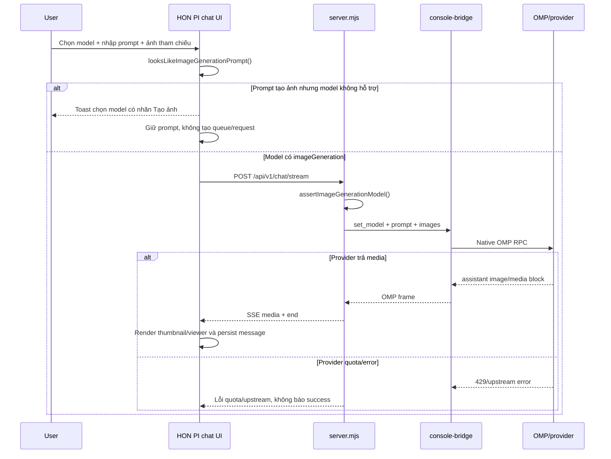

# 11 — Image generation output: incident, fix & session handoff 🔒

**Cập nhật:** 2026-09-24 (Asia/Ho_Chi_Minh)  
**Phạm vi:** HON PI · OMP Usage Dashboard, luồng nhận ảnh đầu vào và tạo/trả ảnh đầu ra.  
**Mục đích:** ghi lại nguyên nhân lỗi, contract sau khi sửa, bằng chứng kiểm thử, giới hạn provider/quota và điểm tiếp nhận cho session kế tiếp.

> Tài liệu nội bộ. Không chứa token, cookie, API key, session ID thật, email tài khoản, transcript nguyên văn hoặc dữ liệu ảnh người dùng. Prompt trong ví dụ đã được rút gọn/anonymize.

---

## 1. Tóm tắt điều hành

### Vấn đề người dùng gặp

Người dùng gửi một ảnh tham chiếu rồi yêu cầu đọc ảnh. Model mặc định đọc ảnh mất khoảng 83,5 giây và trả lời bằng văn bản. Khi người dùng tiếp tục yêu cầu tạo ảnh mới tương tự, đổi sang màu đỏ và nền trong suốt, UI chạy khoảng 60 giây rồi hiển thị:

```text
Stream lỗi
Không nhận được phản hồi: Request was aborted
```

Order bị pause trong queue, nhưng không có assistant image attachment được trả về.

### Nguyên nhân đã xác định

1. Ảnh đầu vào không bị mất. `server.mjs` đã nhận raster image, truyền `images` vào OMP RPC và có logic nhận assistant media block.
2. Model đang chọn là `gemini-3.8-flash`, phù hợp để đọc/phân tích ảnh nhưng không phải image-output model.
3. Prompt tạo ảnh bị gửi vào text model. OMP cố xử lý qua tool/local generation thay vì dùng provider image model; native session kết thúc bằng `stopReason: "error"`, `errorMessage: "Request was aborted"` và `session_exit: "sigterm"`.
4. Catalog OMP có model chuyên tạo ảnh: `gemini-3.1-flash-image`.
5. Lần probe thật vào image model đã đi đúng route nhưng provider trả `429 RESOURCE_EXHAUSTED` (`You have exhausted your capacity on this model`). Vì vậy quota là blocker runtime riêng, không phải lỗi routing/UI.

### Trạng thái sau khi sửa

- Image model được phát hiện và hiển thị rõ trong model picker: **`Gemini 3.1 Flash Image · Tạo ảnh`**.
- Prompt tạo ảnh với model không hỗ trợ bị chặn ngay tại UI, trước khi tạo request/queue item; prompt vẫn còn trong ô nhập.
- Backend cũng chặn độc lập bằng lỗi công khai `IMAGE_GENERATION_MODEL_REQUIRED`, không tin guard của browser.
- Capability API công bố model image-generation thật.
- Assistant image attachment vẫn đi qua SSE `media`, được render và persist như contract media hiện có.
- Quota provider vẫn có thể chặn việc tạo ảnh thật; UI không giả success.

**Kết luận:** đường đi tạo/trả ảnh đã được nối đúng và có guard; việc provider trả ảnh thật phụ thuộc model image-generation còn quota tại thời điểm chạy.

---

## 2. Phạm vi và nguyên tắc kỹ thuật

### Trong phạm vi

- Nhận ảnh đầu vào cùng prompt.
- Phân biệt model đọc ảnh và model tạo ảnh.
- Advertise capability từ runtime thật.
- Chặn sớm prompt không tương thích.
- Giữ media output từ OMP đến UI và transcript.
- Hiển thị lỗi quota/provider có nghĩa.
- Regression test với fake OMP, không tiêu quota thật.

### Ngoài phạm vi

- Không tự sinh ảnh local bằng PIL/SVG để thay thế provider image model.
- Không tự động đổi model ngầm; model switch vẫn do người dùng chọn.
- Không bypass quota, đổi account, hoặc retry vô hạn khi provider trả `429`.
- Không tuyên bố production image generation thành công khi chưa có output attachment thật từ provider.
- Không sửa trực tiếp source trong `~/.omp/usage-dashboard`; source workspace vẫn là nguồn sự thật.

### Nguyên tắc bất biến

1. Capability unavailable/partial không được hiển thị thành success.
2. Browser preflight chỉ là UX; backend validation là security/correctness boundary bắt buộc.
3. Prompt bị guard phải giữ nguyên để người dùng đổi model rồi gửi lại.
4. Assistant media chỉ được coi là tồn tại khi OMP trả block/attachment hợp lệ.
5. Lỗi quota phải dừng lượt có chủ đích; không biến thành ảnh giả hoặc text success giả.

---

## 3. Bằng chứng điều tra

### 3.1. Transcript lỗi

Session lỗi được kiểm tra trong OMP session storage local, với model `google-antigravity/gemini-3.8-flash`:

- OMP đọc ảnh qua input image/clipboard.
- Assistant thực hiện nhiều tool/local attempts để tạo SVG/PIL output.
- Không có assistant image attachment cuối lượt.
- Record cuối có:

```text
stopReason: "error"
errorMessage: "Request was aborted"
duration: 60057.966...
session_exit: "sigterm"
```

Đây là evidence cho việc text model bị abort trong quá trình cố tạo ảnh, không phải evidence rằng provider image model đã chạy.

### 3.2. Catalog model thật

`GET /api/v1/models` trên runtime production trả catalog OMP thật. Tại thời điểm kiểm tra có 127 model, trong đó image model phù hợp là:

```json
{
  "id": "gemini-3.1-flash-image",
  "name": "Gemini 3.1 Flash Image",
  "provider": "google-antigravity",
  "contextWindow": 200000,
  "isDefault": false,
  "imageGeneration": true
}
```

`gemini-3.8-flash` vẫn là default model đọc/phân tích, không được đánh dấu image-generation.

### 3.3. Probe image model thật

Đã chọn `gemini-3.1-flash-image` và gửi prompt yêu cầu trả ảnh PNG chữ đỏ trên nền trong suốt. Request đi tới đúng model nhưng provider trả:

```text
Cloud Code Assist API error (429)
RESOURCE_EXHAUSTED
You have exhausted your capacity on this model.
```

Không có output image từ probe này. Đây là trạng thái quota tại thời điểm probe; không suy diễn thành quota vĩnh viễn.

---

## 4. Kiến trúc luồng sau sửa



### Contract media hiện có

- Input image: attachment `type` bắt đầu bằng `image/`, `data` được tách thành `images` trong native prompt.
- Output image: assistant `message_update`/`message_end`/`agent_end` content block được normalize thành attachment.
- SSE: server phát event `media` với `attachments`.
- UI: `renderMessageAttachments()` hiển thị thumbnail, viewer và lưu message.
- Persist: assistant message lưu `attachments`, sidecar/media persistence giữ dữ liệu theo policy hiện có.

Không cần thêm một pipeline local thứ hai; thay đổi đúng là chọn model có capability và giữ pipeline media thật.

---

## 5. Thay đổi source theo file

### 5.1. `server.mjs`

Các thay đổi chính:

- Thêm suy luận capability trong `normalizeModels()`:
  - Ưu tiên `item.imageGeneration` hoặc `item.capabilities.imageGeneration` nếu upstream công bố.
  - Fallback nhận diện tên/id chứa `image` hoặc `imagen` cho catalog OMP hiện tại.
- Thêm `looksLikeImageGenerationPrompt()` để nhận diện action tạo ảnh và từ khóa media.
- Thêm `isImageGenerationModel()`.
- Thêm `assertImageGenerationModel(prompt, model)`.
- Áp guard ở cả:
  - `POST /api/v1/chat/stream`
  - `POST /api/v1/chat/send`
- Thêm error code công khai `IMAGE_GENERATION_MODEL_REQUIRED`, HTTP `400`.
- Capability response thêm:

```json
{
  "imageGenerationModels": ["gemini-3.1-flash-image"],
  "featureStatus": {
    "image-generation": "supported"
  },
  "media": {
    "imageGeneration": {
      "status": "supported",
      "models": ["gemini-3.1-flash-image"]
    }
  }
}
```

- Mapping lỗi frame có dấu hiệu `429`, `quota`, `resource_exhausted` thành `RATE_LIMITED` với thông báo:

```text
Model đang hết quota hoặc bị giới hạn tạm thời; hãy chọn model khác hoặc thử lại sau.
```

### 5.2. `honpi-chat-dashboard-live.js`

- Thêm client-side image prompt/model predicate.
- Preflight trước khi `enqueuePrompt()` và một lần nữa trong `startPrompt()` để bảo vệ cả retry/queue path.
- Khi model không phù hợp:
  - Toast nêu rõ model hiện tại chỉ đọc/phân tích ảnh.
  - Gợi ý model image-generation đầu tiên trong catalog.
  - Giữ nội dung prompt trong `#chatInput`.
  - Không tạo `POST /api/v1/chat/stream`.
  - Không tạo item trong `#promptQueueTray`.
- Model picker đánh dấu model tạo ảnh bằng `· Tạo ảnh` và `title` giải thích khả năng.
- Capability loader nhận `imageGenerationModels`/`media.imageGeneration` từ API, có fallback an toàn từ catalog.

### 5.3. `honpi-chat-dashboard-legacy.js`

Legacy model popover có listener riêng và từng có thể ghi đè header label. Đã đồng bộ nhãn `· Tạo ảnh` cho model id chứa `image`/`imagen`, tránh UI hiển thị sai sau khi chọn model.

### 5.4. `test-session-actions.mjs`

Đã mở rộng fake OMP:

- Catalog có `smoke-image-model` với `imageGeneration: true`.
- Capability assertion xác nhận image model được advertise.
- Unsupported image-generation prompt với `smoke-model` phải trả HTTP `400` và code `IMAGE_GENERATION_MODEL_REQUIRED` trước dispatch.
- Media contract chạy bằng `smoke-image-model`, xác nhận:
  - input image tới OMP;
  - assistant media event đi qua SSE;
  - image attachment persist trong messages.

---

## 6. Hướng dẫn sử dụng đúng

### Tạo ảnh mới từ ảnh tham chiếu

1. Mở `http://127.0.0.1:4177/chat`.
2. Chọn **Gemini 3.1 Flash Image · Tạo ảnh** trong model picker.
3. Đính kèm ảnh tham chiếu nếu cần.
4. Gửi prompt rõ output, ví dụ:

```text
Tạo một ảnh mới tương tự ảnh tham chiếu, đổi chữ sang màu đỏ, nền trong suốt. Hãy trả ảnh trực tiếp trong phản hồi, không chỉ mô tả bằng chữ.
```

5. Nếu provider còn quota, UI phải nhận `media` và hiển thị thumbnail ảnh.
6. Nếu provider trả quota error, chọn model khác hoặc thử lại sau; không gửi lặp vô hạn.

### Đọc/phân tích ảnh

Có thể dùng `gemini-3.8-flash` hoặc model vision/text phù hợp. Prompt dạng “đọc ảnh này”, “mô tả ảnh”, “trích xuất chữ” không bị image-generation guard chặn.

### Khi thấy `IMAGE_GENERATION_MODEL_REQUIRED`

Đây là lỗi cấu hình model, không phải lỗi ảnh. Giữ prompt, chọn model có nhãn **Tạo ảnh**, rồi gửi lại.

### Khi thấy quota error

Đây là lỗi provider capacity/quota. Guard không thể tự sửa quota. Không xóa session, không tạo SVG/PIL local thay thế nếu mục tiêu là kiểm tra output provider thật.

---

## 7. Capability và trạng thái production

| Capability | Trạng thái | Evidence | Giới hạn |
|---|---|---|---|
| Nhận image attachment | Supported | `test-session-actions.mjs`, media contract | Giới hạn kích thước/type theo attachment policy |
| Đọc/phân tích ảnh | Supported/conditional | Production transcript và model catalog | Phụ thuộc model/account |
| Phát hiện image model | Supported | `/api/v1/models`, capability API | Fallback naming heuristic nếu upstream thiếu field |
| Chặn prompt sai model | Supported | HTTP `400`, UI không tạo stream/queue | Nhận diện prompt heuristic, không phải classifier ngữ nghĩa |
| Trả assistant image attachment | Supported by contract | Fake OMP media regression | Production provider output còn phụ thuộc quota |
| Tạo ảnh thật bằng `gemini-3.1-flash-image` | Conditional | Probe cũ bị `429`; lượt production 2026-09-24 timeout sau 120s, chưa có attachment (xem §8) | Quota tổng tài khoản khả dụng không bảo đảm quota riêng của model/provider |
| Local PIL/SVG fallback | Unavailable/by design | Không triển khai | Tránh giả lập provider output |

Không nâng trạng thái “conditional” thành “fully verified” chỉ vì model xuất hiện trong catalog. Cần một lượt production trả attachment image thật để đóng boundary này.

---

## 8. Verification đã chạy

### Syntax

```text
node --check server.mjs
node --check honpi-chat-dashboard-live.js
node --check honpi-chat-dashboard-legacy.js
```

Kết quả: pass.

### Contract/security

```text
node test-session-actions.mjs
```

Kết quả gần nhất:

```text
session action contract: 39 scenarios passed on isolated port 65365
PASS unsupported image generation is rejected before dispatch
PASS image-generation model returns assistant media and persists the generated image
```

Các scenario session/file/approval/RPC/queue hiện hữu cũng pass trong cùng run.

```text
./test-runtime-security.sh
```

Kết quả: `runtime security smoke: pass`.

### Live browser evidence

Đã deploy runtime và kiểm tra trên `http://127.0.0.1:4177/chat`:

- Model option hiện `Gemini 3.1 Flash Image · Tạo ảnh`.
- Chọn model image cập nhật header thành `gemini-3.1-flash-image · Tạo ảnh`.
- Với model `gemini-3.8-flash` và prompt tạo ảnh:
  - input vẫn giữ nguyên;
  - toast gợi ý model image;
  - queue tray vẫn hidden/rỗng;
  - không có request `/api/v1/chat/stream` hoặc `/api/v1/chat/send`.
- Capability API trả `200` và công bố `gemini-3.1-flash-image`.
- Tab kiểm thử UI guard trước đó đã đóng; giữ lại tab lượt production mới để xem trạng thái timeout/queue.

### Lượt production duy nhất ngày 2026-09-24

- `GET /api/v1/models` và `/api/v1/omp/capabilities`: HTTP `200`; catalog có 127 model và công bố `gemini-3.1-flash-image` là image-generation model.
- Quota quick-check/accounts: HTTP `200`; account đang active có `canUse: true`, quota 5 giờ `9.5%`, quota tuần `70.6%`, `generationStatus: live`. Đây là trạng thái account-level, không chứng minh capacity riêng của image model.
- Gửi đúng một prompt nhỏ với `gemini-3.1-flash-image`; tắt Browser skill chỉ cho lượt này để không prepend `/skill:ego-browser`, rồi khôi phục tùy chọn.
- Stream mở bằng HTTP `200` (`text/event-stream`) nhưng không hoàn tất; UI kết thúc ở `Hết thời gian phản hồi` / `OMP không trả lời trong thời gian cho phép` sau giới hạn 120 giây. Không thu được bằng chứng `media`/`end`; đây là timeout, **không phải** `429`.
- `GET /api/v1/sessions/:id/messages`: HTTP `200`, chỉ có user message; không có assistant message/image attachment. `GET /state` trả HTTP `404`. Console error count `0`.
- Prompt vẫn nằm trong queue paused của UI; không bấm retry và không gửi lại. Production image generation vẫn **chưa được xác minh thành công**.

### Deploy

Deploy bằng:

```sh
./deploy-local-dashboard.sh --restart
```

Backup deploy gần nhất của thay đổi này:

```text
/Users/trannhattuan/.omp/usage-dashboard/backups/deploy/20260924-121113
```

Runtime đang chạy tại:

```text
/Users/trannhattuan/.omp/usage-dashboard
```

---

## 9. Rollback có kiểm soát

Không dùng `git reset --hard`, không xóa `~/.omp`, không xóa session/log.

Nếu cần rollback deployment này:

```sh
./deploy-local-dashboard.sh --rollback /Users/trannhattuan/.omp/usage-dashboard/backups/deploy/20260924-121113
```

Sau rollback:

```sh
curl -fsS http://127.0.0.1:4177/healthz
./test-runtime-security.sh
```

Rollback chỉ phục hồi file dashboard từ backup; không khôi phục/quay ngược quota hoặc OMP provider state.

---

## 10. Rủi ro và điểm cần theo dõi

1. **Provider quota:** image model có thể xuất hiện trong catalog nhưng vẫn trả `429`. Đây là điều kiện runtime, cần hiển thị rõ.
2. **Naming heuristic:** nếu OMP sau này công bố capability field chính thức khác, cập nhật normalizer để ưu tiên field đó; không mở rộng heuristic tùy tiện.
3. **Prompt classifier:** guard chỉ nhận diện action + media keyword; prompt quá ẩn dụ có thể không bị chặn. Backend vẫn là lớp cuối khi model không phù hợp.
4. **Retry semantics:** quota error hiện pause lượt để user chủ động retry/chọn model. Không auto-retry để tránh đốt quota.
5. **Production proof:** probe cũ bị `429`; lượt thử tiếp theo có quota account-level nhưng timeout sau 120 giây, không có assistant attachment. Không retry cùng prompt; trước lượt mới phải điều tra timeout và chỉ gửi khi người dùng yêu cầu.
6. **Model switch policy:** không auto-switch từ text model sang image model vì đó là thay đổi hành vi và quota ngoài ý muốn.

---

## 11. Việc nên làm ở session kế tiếp

Theo thứ tự:

1. Đọc kết quả lượt thử mới ở §8; giữ nguyên kết luận **chưa có production image attachment**.
2. Điều tra timeout của lượt duy nhất (UI queue đang paused; messages API chỉ có user message; state API trả `404`) bằng dữ liệu/log/session hiện có. Không gửi lại prompt, không xóa session/log và không khởi chạy generation mới.
3. Đối chiếu source workspace với runtime trước khi sửa: SHA-256 của `server.mjs` và `honpi-chat-dashboard-live.js` hiện khác nhau; các guard/model/media path liên quan vẫn có trong runtime. Source workspace tiếp tục là nguồn sự thật.
4. Chỉ khi người dùng yêu cầu lượt production mới: đọc lại model/capability và quota/account trước, gửi tối đa một prompt nhỏ, dừng nếu timeout hoặc provider trả `429`.
5. Chỉ nâng trạng thái production khi quan sát được assistant `image/*` attachment thật qua SSE, UI và messages persistence.

---

## 12. Điểm tiếp nhận kỹ thuật

### Source of truth

```text
Workspace source:
/Users/trannhattuan/Documents/CODE/OMP GEMINI Dashboad - Chat UI

Runtime:
/Users/trannhattuan/.omp/usage-dashboard

Dashboard:
http://127.0.0.1:4177/chat

Health:
http://127.0.0.1:4177/healthz

LaunchAgent:
com.trannhattuan.omp-usage-dashboard
```

### File cần đọc trước khi sửa

```text
server.mjs
honpi-chat-dashboard-live.js
honpi-chat-dashboard-legacy.js
console-bridge.mjs
test-session-actions.mjs
test-runtime-security.sh
deploy-local-dashboard.sh
```

### Không được làm khi resume

- Không tự động đổi account/model.
- Không bypass image model quota.
- Không tạo ảnh local để che provider failure.
- Không xóa session thật hoặc transcript để dọn thử nghiệm nếu chưa có yêu cầu.
- Không copy ngược runtime thành source.
- Không quảng cáo image generation production đã pass nếu chưa thấy assistant image attachment thật.

---

## 13. Prompt mở session mới

Copy nguyên khối dưới đây vào session mới:

```text
Tiếp nhận dự án HON PI OMP Dashboard tại:
/Users/trannhattuan/Documents/CODE/OMP GEMINI Dashboad - Chat UI

Đọc trước tài liệu handoff bắt buộc:
/Users/trannhattuan/Documents/CODE/OMP GEMINI Dashboad - Chat UI/📚-OMP-DASHBOARD-TECHNICAL-REPORTS-IMPORTANT-🔒/11-IMAGE-GENERATION-OUTPUT-FIX-AND-SESSION-HANDOFF-IMPORTANT-🔒.md

Mục tiêu tiếp tục:
1. Kiểm tra lại live `GET /api/v1/models`, `GET /api/v1/omp/capabilities` và quota/account; không đổi account/model.
2. Điều tra lượt thử duy nhất gần nhất: model `gemini-3.1-flash-image`, quota account-level được đánh dấu khả dụng, nhưng UI timeout sau 120 giây. Messages API có một user message, không có assistant attachment; state API trả `404`.
3. Không gửi lại prompt đã timeout, không retry, không xóa session/log. Chỉ thực hiện một lượt generation production mới nếu người dùng yêu cầu rõ và quota được kiểm tra lại.
4. Nếu được phép thử mới, xác minh SSE `media` → thumbnail/viewer → messages persistence; dừng ngay khi timeout hoặc `429`, không fallback PIL/SVG.

Trạng thái đã hoàn tất:
- `gemini-3.8-flash` là model đọc/phân tích ảnh; `gemini-3.1-flash-image` xuất hiện trong catalog và capability API.
- Prompt tạo ảnh sai model bị chặn trước queue/request; backend guard `IMAGE_GENERATION_MODEL_REQUIRED` có ở stream và non-stream.
- Fake OMP regression chứng minh assistant image attachment được stream/persist.
- Runtime live trả models/capability `200`, account quota preflight `canUse: true` (5 giờ `9.5%`, tuần `70.6%`).
- Probe production cũ trả `429 RESOURCE_EXHAUSTED`; lượt production mới nhất timeout sau 120 giây, không có `media` event được xác minh và không có assistant attachment trong messages.
- Prompt thử vẫn paused trong UI; không retry. Chưa được claim production image generation pass.
- Runtime đã deploy bằng `./deploy-local-dashboard.sh --restart`; backup gần nhất:
  `/Users/trannhattuan/.omp/usage-dashboard/backups/deploy/20260924-121113`
- Verification lịch sử: `node test-session-actions.mjs` = 39 scenarios; `./test-runtime-security.sh` = pass; `/healthz` = `{"ok":true}`. Lượt kiểm tra mới không chạy lại test suite.

Ràng buộc:
- Source workspace là nguồn sự thật; không sửa trực tiếp `~/.omp/usage-dashboard`.
- Không dùng `git reset --hard`, không xóa `~/.omp`, session hoặc log.
- Không tự động đổi account/model; không gửi lại lượt timeout nếu chưa được yêu cầu.
- Không báo success nếu chưa quan sát output thật từ provider.
- Không triển khai local image fallback để che quota/provider failure.
- Bắt đầu bằng đọc report và kiểm tra live capability/quota; không làm lại các thay đổi đã hoàn tất.
```

---

## 14. Kết luận

Lỗi ban đầu là lỗi chọn capability/model và thiếu preflight, không phải lỗi nhận ảnh hoặc render media. Sau sửa, UI và backend phân biệt rõ model đọc ảnh với model tạo ảnh; prompt sai model dừng trước queue. Output image path có contract và fake OMP regression, nhưng production image generation vẫn chưa được xác minh: lượt mới nhất timeout dù quota account-level khả dụng và không trả assistant image attachment. Cần điều tra timeout trước bất kỳ lượt production mới nào.
